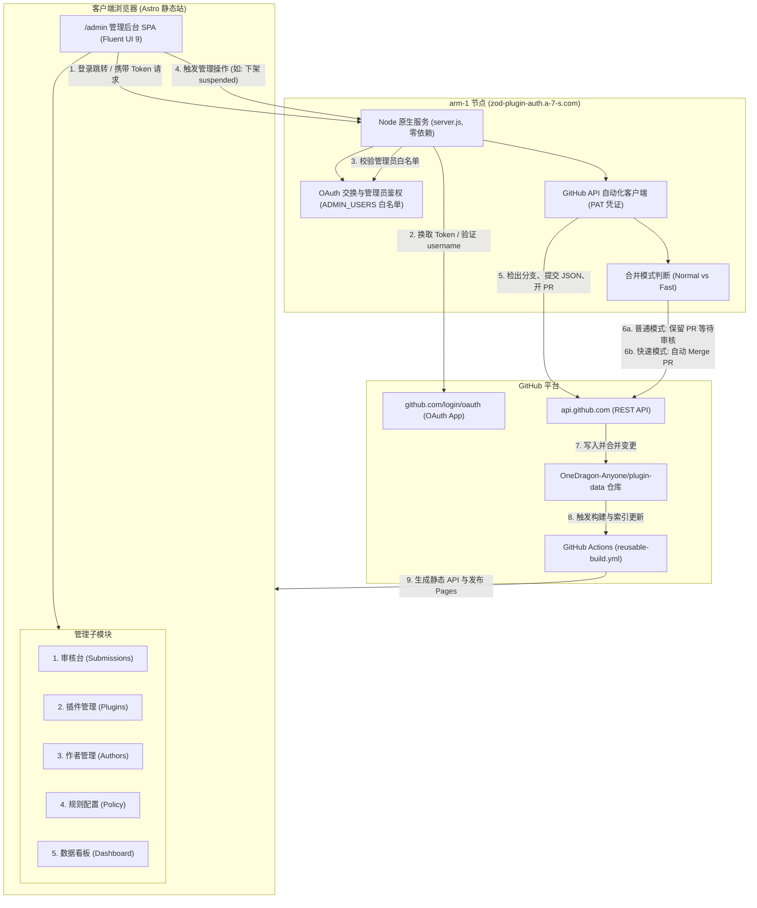
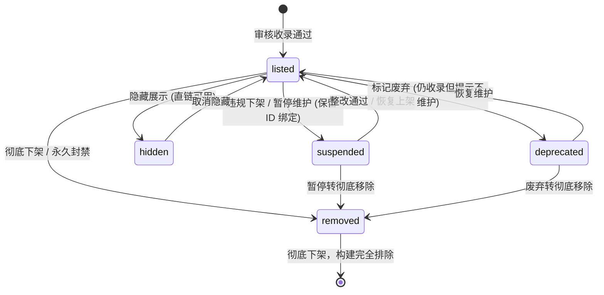

# 技术设计：插件管理后台架构与 GitHub PR 写入模型方案

- **需求来源**: Issue [Z0D-3] / [Z0D-9]
- **架构决策依据**: 人类拍板决策（第一期聚焦「插件管理后台」，核心诉求为插件下架功能与完整运维治理能力；零数据库，以 `plugin-data` 仓库作为唯一真实数据源；服务端通过 GitHub API 自动提 PR 写入；支持普通/快速合并模式开关；Node 零依赖服务部署于 arm-1）
- **设计负责人**: Architect
- **状态**: 待评审（G1 阶段）
- **交付目标路径**: `docs/design/Z0D-3/design.md`

---

## 1. 理解：系统当前做什么与核心架构前提

### 1.1 现状架构分析
`plugin-market` 前端是基于 Astro 7.x 框架构建的**纯静态站点**（`astro.config.mjs` 配置 `output: "static"`），采用 React 19 + Fluent UI 9 进行客户端组件渲染，部署于 GitHub Pages。

```text
┌────────────────────────────────────────────────────────────────────────┐
│                        现有架构数据与控制链路                            │
├─────────────────┬──────────────────────────────────────────────────────┤
│ 页面呈现与交互   │ Astro (SSG) + React Fluent UI (@/components/fluent)   │
│                 │ 路由：/ (市场)、/submission (提交)、/policy、/api-docs │
├─────────────────┼──────────────────────────────────────────────────────┤
│ 数据源与存储     │ 静态 JSON API (public/api/v1/plugins.json & stats)    │
│                 │ 数据仓元数据 (OneDragon-Anyone/plugin-data)            │
├─────────────────┼──────────────────────────────────────────────────────┤
│ 收录与审核链路   │ GitHub Issue 提交申请 ([submission])                  │
│                 │ GitHub Actions (reusable-submission-bot.yml) 触发    │
│                 │ 校验脚本：scripts/lib/validator.ts 调用 Python 3.11   │
│                 │ 扫描脚本：scripts/scan/* (静态/依赖/恶意安全扫描)     │
│                 │ 结果反馈：Issue 评论 + 自动打标 (pending/rejected 等)  │
├─────────────────┼──────────────────────────────────────────────────────┤
│ 构建发布流程     │ scripts/build.ts 聚合生成 public/api/v1/ 静态索引     │
└─────────────────┴──────────────────────────────────────────────────────┘
```

### 1.2 需求与范围调整背景
人类在需求澄清中明确：**原先「第一期只做登录+作者查看」为早期范围误判，真实核心诉求为「插件管理后台」，最核心功能为「插件下架」以及全套运维治理能力**。
- **管理后台（唯一交付物）**：审核台、插件管理（含下架/上架/隐藏/废弃）、作者管理、规则配置、数据看板。
- **读写模型原则**：数据源仍是 `plugin-data` 仓库的 JSON（构建时读取与静态 API 分发），**彻底不引入任何外部数据库**。后台的所有状态写操作均通过 GitHub API **自动提交 Pull Request** 到 `plugin-data` 仓库。
- **模式开关**：默认提交 PR 待人工审核合并；开启「快速模式」后提 PR 立即自动合并。
- **审计记录**：Git Commit 记录谁在何时改了什么及原因，保持完整、不可篡改的变更审计。
- **基础设施复用**：复用 arm-1（Ubuntu ARM 节点，已接入 `zod-plugin-auth.a-7-s.com` cloudflared 隧道与 CORS），部署 Node 原生零依赖常驻后端服务。

---

## 2. 非目标：明确不做的事

1. **不引入外部数据库**：不引入 MySQL、PostgreSQL、MongoDB、Redis、Supabase 等任何数据库服务，所有插件元数据、封禁策略、全局规则均保存在 `plugin-data` 仓库的 Git 历史中。
2. **第一期彻底排除作者侧视图**：砍掉作者登录查看名下插件与校验状态的前端页面。作者仍沿用既有的 GitHub Issue 自动回帖机制获取校验与扫描结论。
3. **前端绝不持有写权限 PAT**：Fine-grained PAT 仅由 arm-1 服务端环境变量持有，严禁下发给前端或写入静态产物。
4. **不破坏既有静态站功能与构建流程**：现有市场首页、插件详情页、规范页、API 导出（`pnpm build`）保持 100% 兼容与零破坏。
5. **不重构现有提交机器人核心逻辑**：Issue 提交入口与 GitHub Actions 规则检查保持稳定，管理后台通过标准 API 与 Git 机制与之协同。

---

## 3. 建议改动：最小可行方案与技术架构设计

### 3.1 总体架构与数据流向

整个插件管理后台由 **前端管理界面（Astro `/admin` 路由下挂载 Fluent UI SPA）**、**arm-1 后端管理与认证服务（Node 24 原生零依赖）**、**GitHub 官方 API** 以及 **`plugin-data` 仓库** 组成。



---

### 3.2 GitHub PR 读写模型架构

#### 3.2.1 读模型（Read Flow）
- **公开数据读取**：管理后台前端直接读取当前发布的 `public/api/v1/plugins.json`、`stats.json` 以及 `plugin-data` 仓库主分支公开数据（如 `market/policy.json`），免鉴权且零延迟。
- **待审与动态数据读取**：管理端通过 arm-1 服务端接口 `GET /api/admin/submissions` 聚合读取当前所有带有 `submission` 标签的开放 Issue 及其扫描/校验状态。

#### 3.2.2 写模型（Write Flow）
服务端持有精细化个人访问令牌（Fine-grained PAT，环境变量 `PLUGIN_DATA_PAT`），该 Token 权限严格限定为 `OneDragon-Anyone/plugin-data` 仓库的 `contents:write` + `pull_requests:write`。

当管理员在后台触发任何写操作（如修改状态、下架插件、封禁作者、修改 policy）时，服务端执行以下标准 Git/PR 自动化编排：

```text
[管理员操作]
     │
     ▼
[Step 1] 获取 plugin-data 默认分支 (如 master/main) 最新 Commit SHA:
         GET /repos/:owner/:repo/git/ref/heads/:baseBranch
     │
     ▼
[Step 2] 动态创建管理操作临时分支:
         POST /repos/:owner/:repo/git/refs
         Branch: refs/heads/admin/<action>-<target>-<timestamp>
     │
     ▼
[Step 3] 提交变更文件 (带最新 file SHA 防覆盖冲突):
         PUT /repos/:owner/:repo/contents/market/plugins/<id>.json 或 policy.json
         Body: { message, content (base64), sha, branch }
     │
     ▼
[Step 4] 创建 Pull Request:
         POST /repos/:owner/:repo/pulls
         Head: admin/<action>-<target>-<timestamp>
         Base: master
         Title: <规范 PR 标题>
         Body: <结构化审计 PR 正文>
     │
     ▼
[Step 5] 模式分支判定 (Normal vs Fast):
         ├─ 普通模式 (默认): 保持 PR 处于 Open 状态，返回 PR 链接供管理员核对。
         └─ 快速模式 (Fast Mode):
              调用 PUT /repos/:owner/:repo/pulls/:number/merge
              自动执行 Squash & Merge，并调用 DELETE /git/refs/heads/<branch> 清理分支。
```

#### 3.2.3 模式开关（Normal Mode vs Fast Mode）
1. **普通模式（默认）**：
   - 目标：确保高危写操作具备第二道人工屏障与可撤销性。
   - 行为：PR 创建完毕后保持开放状态，接口返回 `{ prNumber, prUrl, merged: false }`，管理员可在 GitHub 界面再次确认文件 diff 后手动合并。
2. **快速模式（Fast Mode）**：
   - 目标：提升日常轻量管理效率（如一键下架紧急违规插件、批量更新镜像源）。
   - 行为：服务端在 PR 创建成功后，立即调用 GitHub API `PUT /repos/:owner/:repo/pulls/:number/merge` 执行自动合并，合并方式固定为 `squash`，合并完成后自动删除临时 feature 分支，返回 `{ prNumber, prUrl, merged: true }`。
   - 模式控制级别：
     - **服务端总开关**：环境变量 `ENABLE_FAST_MERGE=true|false`（若未开启或 PAT 仅有 PR 权限无合并权，则服务端安全降级为普通模式并友好提示）。
     - **前端调用级开关**：管理后台写操作表单提供「直接合并 (快速模式)」勾选框（默认不勾选），供管理员按需自主决定。

#### 3.2.4 审计机制（Audit Trail）
为保证完全追溯「谁在何时以何种理由修改了系统状态」，每次写入必须生成规范的 Git Commit Message 与 PR 正文：

- **Git Commit Message 规范**：
  ```text
  admin(<action>): <target_id> <status_or_change>

  Operator: @<admin_github_username>
  Action: <status_change|ban_author|update_policy|pin_toggle>
  Reason: <admin_audit_reason>
  Request-ID: <uuid_v4>
  Timestamp: <ISO-8601 UTC>
  Fast-Mode: <true|false>
  ```

- **PR Description 结构化审计正文**：
  ```markdown
  ### 🛡️ 管理后台操作记录
  - **操作人**: @{adminUsername}
  - **操作动作**: {actionDescription}
  - **影响对象**: `{targetId}`
  - **操作理由**: {reason}
  - **时间戳**: {isoUtcTime}
  - **合并模式**: {mode}
  - **变更详情**:
    ```diff
    - "status": "listed"
    + "status": "suspended"
    ```
  ---
  *由 ZZZOD 插件管理后台自动提交。*
  ```

---

### 3.3 插件状态机与下架映射

#### 3.3.1 合法状态集合定义
根据 `src/lib/types.ts` 与 `scripts/lib/market.ts`，插件生命周期包含 5 种严格合法的状态值：
`MarketStatus = "listed" | "hidden" | "deprecated" | "suspended" | "removed"`



#### 3.3.2 各状态语义、存储变更与构建影响映射表

| 状态值 | 业务语义与定位 | `market/plugins/<id>.json` 修改 | `scripts/build.ts` 构建系统处理与影响 | 客户端与静态站呈现 |
| :--- | :--- | :--- | :--- | :--- |
| **`listed`** | **正常在架**。<br>已通过审核，公开发布。 | `status: "listed"` | 正常抓取 Release；写入 `plugins.json`、`search-index.json` 及单个插件详情 JSON；`STATUS_RANK` 为最高优先级（0）。 | 市场列表与搜索正常可见，客户端正常安装。 |
| **`suspended`** | **暂停上架（违规临时下架）**。<br>插件可能存在合规争议或临时故障，**保留插件 ID 与原仓库的绑定关系，防止被他人恶意抢注**。可恢复。 | `status: "suspended"` | 仍参与构建生成详情，但在写入 `search-index.json` 时**被严格过滤排除**；在 `plugins.json` 中保留但 `STATUS_RANK` 垫底（3）。 | 搜索框搜不到；市场列表标记「已暂停」并标灰；客户端不推荐更新或禁用。 |
| **`hidden`** | **隐藏插件**。<br>不希望在市场公共列表露出，但插件仓库依然有效。 | `status: "hidden"` | 从 `search-index.json` 中**被严格过滤排除**；不出现在首页推荐；仍构建独立 `plugins/<id>.json`。 | 市场首页与搜索不可见；持有直接链接 `/#/plugins/<id>` 的用户仍可查看详情与下载。 |
| **`deprecated`** | **已废弃**。<br>作者放弃维护或已被新插件替代，仍允许旧用户下载。 | `status: "deprecated"` | 依然进入 `search-index.json` 和 `plugins.json`，排序排在 listed 之后（`STATUS_RANK: 1`）。 | 列表与详情页面展示醒目的「已废弃」警示徽章，建议迁移。 |
| **`removed`** | **彻底移除（永久下架）**。<br>严重恶意插件或侵权插件被永久清除。 | `status: "removed"` | **彻底跳过构建**（`build.ts` 行 43：`if (entry.status === "removed") continue;`）；**完全不输出**到 `plugins.json`、`search-index.json` 与详情 API。 | 静态站完全消失；API 查不到；客户端视同不存在。历史 ID 仅留存在 git 记录中。 |

---

### 3.4 arm-1 服务端接口与权限契约

#### 3.4.1 服务架构与部署约束
- **单文件零第三方依赖**：采用 Node 24 原生 `node:http`, `node:https`, `node:crypto` 模块实现，代码放置于 `services/oauth-bridge/server.js`。
- **运行环境**：arm-1 节点 Docker 容器（基于 `node:24-alpine`，镜像约 50MB）。
- **网络暴露**：绑定内部 `127.0.0.1:3000`，由既有 cloudflared 隧道将 `zod-plugin-auth.a-7-s.com` 流量反向代理至此端口，**不新建隧道**。
- **跨域策略（CORS）**：
  - `Access-Control-Allow-Origin`: 生产为 `https://onedragon-anyone.github.io`（以及人类配置的域名），本地为 `http://localhost:4321`。
  - `Access-Control-Allow-Methods`: `GET, POST, OPTIONS`。
  - `Access-Control-Allow-Headers`: `Content-Type, Authorization, X-Request-ID`。

#### 3.4.2 认证与鉴权模型（Admin Auth & Session）
1. **GitHub OAuth 登录**：
   - 管理员在前端点击「管理员登录」，生成随机 `state` 存入 `sessionStorage`，跳转至 GitHub OAuth 授权（Scope: `read:user`）。
   - GitHub 回调携带 `code` 与 `state`，前端提交至服务端 `POST /api/auth/exchange`。
2. **管理员白名单校验**：
   - 服务端使用 `client_secret` 向 GitHub 换取用户 `access_token`。
   - 服务端立即请求 `https://api.github.com/user` 获取当前登录用户的 GitHub `login`（用户名）。
   - 服务端比对环境变量 `ADMIN_USERS`（逗号分隔的管理员用户名列表，如 `ADMIN_USERS="owner1,admin2"`）。
   - 若用户名不在白名单中，**直接返回 403 Forbidden**，阻断会话建立。
3. **安全会话凭证（HMAC Session Token）**：
   - 验证通过后，服务端利用环境变量 `SESSION_SECRET`，使用 Node `node:crypto` 签发加密签名 Session Token：
     `session_token = base64url(header) + "." + base64url(payload) + "." + hmac_sha256(payload, SESSION_SECRET)`
   - Payload 包含：`{ username: "...", role: "admin", exp: now + 8 * 3600 }`（8 小时有效期）。
   - 前端接收后存入 `sessionStorage`（标签页关闭即销毁）。所有管理接口在请求头携带 `Authorization: Bearer <session_token>`。

#### 3.4.3 管理端 RESTful API 契约设计

| 接口方法与路径 | 功能说明 | 请求头 / 参数 | 请求 Body (JSON) | 响应状态与 Body 核心字段 |
| :--- | :--- | :--- | :--- | :--- |
| `GET /health` | 服务健康检查 | 无 | 无 | `200 OK`<br>`{ "status": "ok", "uptime": 12345 }` |
| `POST /api/auth/exchange` | OAuth 换票与管理员鉴权 | 无 | `{ "code": "string", "state": "string" }` | `200 OK`<br>`{ "sessionToken": "...", "user": { "login": "...", "avatar_url": "..." }, "role": "admin" }`<br>*(非管理员返回 403 Forbidden)* |
| `GET /api/admin/me` | 当前会话状态与信息 | `Authorization: Bearer <token>` | 无 | `200 OK`<br>`{ "authenticated": true, "user": { ... }, "permissions": ["all"] }` |
| `GET /api/admin/submissions` | 待审核插件列表 | `Authorization: Bearer <token>` | Query: `?status=pending&page=1` | `200 OK`<br>`{ "submissions": [{ "issueNumber": 12, "id": "my_plugin", "repo": "...", "status": "pending", "scanResults": { ... } }] }` |
| `POST /api/admin/submissions/:issue/review` | 审核插件（通过/拒绝） | `Authorization: Bearer <token>` | `{ "action": "approve" \| "reject", "reason": "理由说明", "fastMode": false }` | `200 OK`<br>`{ "issueNumber": 12, "status": "approved" \| "rejected", "prUrl": "...", "merged": false }` |
| `GET /api/admin/plugins` | 插件全量管理列表 | `Authorization: Bearer <token>` | Query: `?status=all&q=...` | `200 OK`<br>`{ "plugins": [MarketSourceEntry...] }` |
| `POST /api/admin/plugins/:id/status` | **变更插件状态（下架/恢复）** | `Authorization: Bearer <token>` | `{ "status": "suspended" \| "removed" \| "hidden" \| "deprecated" \| "listed", "reason": "必填下架或变更理由", "fastMode": false }` | `200 OK`<br>`{ "id": "foo", "previousStatus": "listed", "newStatus": "suspended", "prNumber": 45, "prUrl": "...", "merged": false }` |
| `POST /api/admin/plugins/:id/tags` | 编辑插件标签与额外风险 | `Authorization: Bearer <token>` | `{ "tags": ["tag1", "tag2"], "extraRisk": ["network"], "reason": "...", "fastMode": false }` | `200 OK`<br>`{ "id": "foo", "prUrl": "...", "merged": false }` |
| `POST /api/admin/plugins/:id/pin` | 置顶 / 取消置顶 | `Authorization: Bearer <token>` | `{ "pinned": true \| false, "reason": "...", "fastMode": false }` | `200 OK`<br>`{ "id": "foo", "pinned": true, "prUrl": "..." }` |
| `POST /api/admin/plugins/:id/mirror` | 补录/更新下载镜像地址 | `Authorization: Bearer <token>` | `{ "mirror": ["https://cnb.cool/..."], "reason": "...", "fastMode": false }` | `200 OK`<br>`{ "id": "foo", "mirror": [...], "prUrl": "..." }` |
| `GET /api/admin/authors` | 作者列表与提交记录统计 | `Authorization: Bearer <token>` | Query: `?page=1&limit=20` | `200 OK`<br>`{ "authors": [{ "username": "...", "pluginsCount": 3, "banned": false }] }` |
| `POST /api/admin/authors/:username/ban` | 封禁 / 解封作者 | `Authorization: Bearer <token>` | `{ "ban": true \| false, "banRepoIds": [12345], "reason": "...", "fastMode": false }` | `200 OK`<br>`{ "username": "...", "banned": true, "prUrl": "..." }` *(更新 policy.json)* |
| `GET /api/admin/policy` | 获取全局规则配置 | `Authorization: Bearer <token>` | 无 | `200 OK`<br>`{ "policy": MarketPolicy }` |
| `POST /api/admin/policy` | 更新全局规则配置 | `Authorization: Bearer <token>` | `{ "policy": MarketPolicy, "reason": "...", "fastMode": false }` | `200 OK`<br>`{ "policy": MarketPolicy, "prUrl": "..." }` *(更新 policy.json)* |
| `GET /api/admin/dashboard` | 管理看板聚合数据 | `Authorization: Bearer <token>` | 无 | `200 OK`<br>`{ "totalPlugins": 42, "statusDistribution": { "listed": 38, "suspended": 2, "deprecated": 2 }, "totalDownloads": 120500, "starsRanking": [...] }` |
| `POST /api/admin/sync` | 手动触发市场静态索引构建 | `Authorization: Bearer <token>` | 无 | `202 Accepted`<br>`{ "dispatched": true, "message": "Build workflow triggered" }` |

#### 3.4.4 标准错误码响应定义
所有 API 失败时统一返回 JSON 格式：`{ "error": string, "message": string, "requestId": string }`
- `400 Bad Request`：参数缺失或格式不合规（如状态值非法、未填写下架理由）。
- `401 Unauthorized`：未提供有效 Session Token 或 Token 已过期。
- `403 Forbidden`：当前 GitHub 账号不在 `ADMIN_USERS` 白名单中，拒绝访问。
- `404 Not Found`：目标插件 ID 或 Issue 不存在。
- `409 Conflict`：Git 提交冲突（检测到远程文件 SHA 已变动，详见 6.2 节）。
- `422 Unprocessable Entity`：业务校验失败（如 ID 违反命名规则、标签超过 8 个）。
- `500 Internal Server Error`：服务端内部异常。
- `502 Bad Gateway`：调用 GitHub API 上游失败或网络超时。

---

### 3.5 前端后台管理系统架构与交互设计（Fluent UI）

#### 3.5.1 页面路由与挂载
- **页面入口**：`src/pages/admin.astro`（或 `src/pages/admin/index.astro`）。
- **布局容器**：复用现有的 `src/layouts/AppLayout.astro`，页面内部挂载 `AdminApp.tsx`（客户端 hydration：`client:only="react"`）。
- **组件主题与视觉风格**：严格遵循 Fluent UI 9 风格体系与 Win11 主题规范（`win11.ts`、`FluentShell.tsx`），保持与既有插件市场一致的磨砂亚克力、圆角与排版质感。

#### 3.5.2 管理后台子模块与交互结构

```text
┌────────────────────────────────────────────────────────────────────────┐
│  ZZZOD 插件管理后台                               [👤 Admin: @username] │
├────────────────────────────────────────────────────────────────────────┤
│  [ Tab: 审核台 ]  [ Tab: 插件管理 ]  [ Tab: 作者管理 ]  [ Tab: 规则配置 ]  [ Tab: 数据看板 ]
├────────────────────────────────────────────────────────────────────────┤
│ 1. 审核台 (Submissions Tab):                                           │
│    - 待审核列表表格 (DataGrid)：Issue 编号、插件 ID、提交人、扫描状态    │
│    - 查看详情抽屉 (Drawer)：显示三类扫描结论 (静态/依赖/恶意) 与 Manifest│
│    - 操作按钮：[通过并开 PR] / [拒绝并回帖] (支持附带审核评语)          │
│                                                                        │
│ 2. 插件管理 (Plugins Tab - 核心):                                      │
│    - 状态筛选栏：[全部] [在架 (listed)] [已暂停 (suspended)] [已废弃]   │
│    - 快速搜索框：按 ID / 名称 / 仓库过滤                                │
│    - 插件数据行与操作列：                                                │
│      • [下架 / 变更状态] 按钮 ──> 唤起状态变更弹窗 (Dialog)             │
│        - 选择目标状态：suspended (暂停) / removed (移除) / hidden / ...│
│        - 必填：变更理由 (写入 Commit 与 PR)                             │
│        - 开关：[ ] 开启快速合并模式 (直接 Merge)                        │
│      • [置顶开关] / [编辑标签] / [配置镜像源]                           │
│                                                                        │
│ 3. 作者管理 (Authors Tab):                                             │
│    - 作者列表、提交历史数量、当前状态                                  │
│    - 操作：[封禁作者] ──> 同步写入 bannedUsers 与 bannedRepoIds (提 PR) │
│                                                                        │
│ 4. 规则配置 (Policy Tab):                                              │
│    - 保留 ID 列表 (reservedIds) 动态增删                                │
│    - 资源阈值：maxZipBytes、maxCoverBytes、限流阈值编辑                 │
│    - 提交保存 ──> 自动向 plugin-data 提交 policy.json PR                │
│                                                                        │
│ 5. 数据看板 (Dashboard Tab):                                           │
│    - 统计卡片：在架插件总数、下架/暂停数、全网总下载量、总星标           │
│    - 状态分布环形图 / 下载 Top 10 排行榜                                │
│    - [立即触发构建同步] 快捷动作按钮                                    │
└────────────────────────────────────────────────────────────────────────┘
```

#### 3.5.3 安全与防注入规范
- **硬性安全防线（纯文本渲染）**：审核列表、Issue 回帖展示、插件描述及用户提供的扫描日志**一律按纯文本（Plain Text）安全渲染**，严禁使用 `dangerouslySetInnerHTML`，杜绝任何外部输入引发的 DOM XSS 漏洞。
- **敏感操作二次确认**：对 `suspended`、`removed`、作者封禁等具有下架/阻断效力的操作，必须弹出 Modal/Dialog 进行显式二次确认，且理由字数不得少于 5 个字符。

---

## 4. 受影响组件与文件清单

| 文件 / 模块路径 | 变更类型 | 说明与影响评估 | 对构建流程的影响 (`pnpm build`) |
| :--- | :--- | :--- | :--- |
| `src/pages/admin.astro` | **新增** | 管理后台入口页面，引入 `AdminApp` 组件并以 `client:only="react"` 渲染 | **零破坏**。新增独立静态页面路由。 |
| `src/components/app/AdminApp.tsx` | **新增** | 管理后台根组件，包含管理员登录拦截、TabBar 切换、全局通知浮层 | 客户端渲染组件，无副作用。 |
| `src/components/admin/SubmissionsPanel.tsx` | **新增** | 审核台面板：待审 Issue 查询、扫描详情查看、通过/拒绝动作 | 独立管理组件。 |
| `src/components/admin/PluginsPanel.tsx` | **新增** | **插件管理主面板**：状态变更弹窗、下架操作流、置顶/标签/镜像编辑 | 核心管理组件。 |
| `src/components/admin/AuthorsPanel.tsx` | **新增** | 作者管理面板：作者列表统计、封禁/解封管理 | 独立管理组件。 |
| `src/components/admin/PolicyPanel.tsx` | **新增** | 规则配置面板：保留 ID、限流与包大小限制的读取与 PR 提交表单 | 独立管理组件。 |
| `src/components/admin/DashboardPanel.tsx` | **新增** | 数据看板面板：插件健康状态分布、下载趋势与构建同步触发按钮 | 独立管理组件。 |
| `src/lib/admin-api.ts` | **新增** | 前端管理 API 客户端：封装与 arm-1 服务端（`zod-plugin-auth.a-7-s.com`）的通信及 Token 自动携带 | 工具库，无构建破坏。 |
| `services/oauth-bridge/server.js` | **新增/扩充** | arm-1 Node 24 原生零依赖常驻后端服务：管理员鉴权、GitHub PAT PR 写入客户端、REST API 路由 | **独立服务目录**，完全不参与前端 Astro 打包。 |
| `services/oauth-bridge/Dockerfile` | **新增** | 生产镜像构建文件，基于 `node:24-alpine` | 独立容器镜像。 |
| `scripts/lib/market.ts` / `src/lib/types.ts` | **复用/参照** | 复用现有的 `MarketStatus`, `MarketPolicy`, `MarketSourceEntry` 类型与校验规范 | 保持现有一致，无需改动。 |
| `scripts/build.ts` | **无改动** | 保持原有逻辑：已原生支持 `suspended` 索引过滤和 `removed` 彻底排除 | **零改动，零破坏**。 |

---

## 5. 实现步骤：给 Dev 的具体开发步骤

### 阶段一：arm-1 后端管理服务扩充 (`services/oauth-bridge/`)
1. **搭建 GitHub API 自动化写入模块**：
   - 在 `services/oauth-bridge/github-client.js` 中封装原生 `fetch` 请求。
   - 实现分支检出（`GET /git/ref` -> `POST /git/refs`）。
   - 实现文件提交（`PUT /contents/:path`，自动计算 base64 并比对文件最新 SHA）。
   - 实现 PR 创建（`POST /pulls`）以及快速合并（`PUT /pulls/:number/merge`）。
2. **扩充管理员鉴权与会话中间件**：
   - 在 `POST /api/auth/exchange` 中换票后，请求 GitHub `/user` 校验 `ADMIN_USERS` 环境变量白名单。
   - 使用 Node `crypto.createHmac` 生成加密 Session Token，实现 `requireAdmin` 拦截逻辑。
3. **实现全套 Admin REST API**：
   - 逐项实现 3.4.3 节规定的 REST 路由，确保所有写操作组装规范的 Git Commit 审计信息。
   - 写入统一的 CORS 响应头与 OPTIONS 预检支持。

### 阶段二：前端管理后台界面开发 (`src/pages/admin.astro` & `src/components/admin/`)
1. **创建 `/admin` 页面与主框架**：
   - 创建 `src/pages/admin.astro`，挂载 `AdminApp`。
   - 搭建管理员登录状态拦截器：未登录显示「GitHub 管理员登录」入口；非管理员登录提示 403 无权限并支持登出。
2. **实现各功能面板（Fluent UI 9）**：
   - **插件管理面板（核心优先级）**：加载全部插件列表，点击下架弹出 Dialog，选择 `suspended` / `removed` 等合法状态，录入必填原因，勾选快速模式，调用接口并展示提交的 PR 链接。
   - **审核台面板**：展示 pending Issue 列表及扫描简报，支持一键审核通过。
   - **作者管理面板**：展示作者维度数据，支持封禁拉黑并提交 policy PR。
   - **规则配置面板**：展示与编辑 `policy.json` 配置项。
   - **数据看板面板**：以卡片和统计图呈现插件状态比例与下载量。

### 阶段三：环境配置与联调验证
1. **arm-1 容器配置**：
   - 注入环境变量：`PORT=3000`、`GITHUB_CLIENT_ID`、`GITHUB_CLIENT_SECRET`、`PLUGIN_DATA_PAT`、`ADMIN_USERS`、`SESSION_SECRET`、`ALLOWED_ORIGIN`、`ENABLE_FAST_MERGE`。
   - cloudflared 隧道规则绑定：`zod-plugin-auth.a-7-s.com -> http://127.0.0.1:3000`。
2. **前后端联调测试**：
   - 在本地 `pnpm dev` 联调管理后台与 arm-1 接口。
   - 运行 `pnpm check` 与 `pnpm build` 确认静态站点打包零报错。

---

## 6. 验证方式：给 Tester 的验证计划

### 6.1 核心功能正常路径验证
1. **管理员登录与鉴权验证**：
   - 使用白名单中的 GitHub 账号登录，顺利换取 Token 并进入 `/admin` 仪表盘。
   - 使用非白名单 GitHub 账号登录，前端明确展示「403 Forbidden：您不是系统管理员」，阻断进入。
2. **插件下架流程验证（核心用例）**：
   - **暂停下架（`suspended`）**：在后台将指定插件状态置为 `suspended` 并提交。
     - 验证 GitHub `plugin-data` 仓库成功生成 `admin/suspend-<id>-*` 分支及 PR。
     - PR 描述中清晰包含操作人、操作理由与 diff。
     - PR 合并后触发构建，验证生成的 `search-index.json` 中该插件已被剔除，`plugins.json` 中状态变为 `suspended`。
   - **彻底下架（`removed`）**：将指定插件状态置为 `removed`。
     - 验证 PR 合并构建后，`public/api/v1/plugins.json` 与 `search-index.json` 完全不包含该插件，详情 JSON 不复存在。
   - **恢复上架（`listed`）**：将 `suspended` 插件重新修改为 `listed`，验证 PR 合并后搜索索引恢复收录。
3. **模式开关测试**：
   - **普通模式**：提交下架操作，确认 PR 处于 Open 状态，未被自动合并。
   - **快速模式**：勾选「快速模式」提交下架，确认 GitHub API 自动将 PR Squash & Merge，临时分支被自动删除。
4. **规则配置与作者封禁验证**：
   - 修改保留 ID 或封禁某作者，验证 `market/policy.json` 被更新且生成结构化 PR。

### 6.2 异常与边界场景测试
1. **并发修改与 Git SHA 冲突测试（409 Conflict）**：
   - 场景：两名管理员同时针对同一个插件提交修改，或者在后台提 PR 的同时远程仓库发生其他提交。
   - 预期表现：服务端捕获 GitHub 的 409/422 异常，自动重新拉取目标文件最新 SHA 并尝试安全重试（最大重试 3 次）；若发生实质性内容冲突，返回明确的 409 提示告知用户刷新重试。
2. **GitHub API Rate Limit 触发测试**：
   - 场景：高频触发列表拉取或提交。
   - 预期表现：服务端在内存中对只读数据维持短效缓存（TTL 60s）；若遇到 429 或 `x-ratelimit-remaining: 0`，接口优雅返回 502 及等待时间提示，不造成服务崩溃。
3. **网络超时与降级测试**：
   - 场景：arm-1 节点与 GitHub API 通信抖动或超时。
   - 预期表现：服务端设置 10 秒超时中断，向前端返回 `upstream_timeout` 错误；前端保留用户填写的表单草稿，避免重复输入。
4. **会话过期与伪造 Token 测试**：
   - 场景：修改 Session Token 中的 signature 或等待 8 小时 Token 自然过期。
   - 预期表现：管理端接口立即返回 401 Unauthorized，前端自动清理 `sessionStorage` 并重定向至登录页。

---

## 7. 风险与已知边界情况

| 风险项 | 潜在影响 | 架构防御与缓解策略 |
| :--- | :--- | :--- |
| **PAT 凭证泄露风险** | 若 PAT 泄露，攻击者可向 `plugin-data` 恶意提 PR 或修改内容。 | 1. 采用 Fine-grained PAT，权限严格限定在单一数据仓的 `contents:write` + `pull_requests:write`；<br>2. PAT 仅存在于 arm-1 生产机环境变量，严禁写入 Git 代码库、Docker 镜像或返回给浏览器；<br>3. 前端完全无感知 PAT，仅持有签名短效 Session Token。 |
| **GitHub API Rate Limit 耗尽** | 频繁调用 GitHub API 导致接口被限流阻断。 | 1. 静态可读数据（插件全量列表、数据看板）优先直接读取 GitHub Pages 发布的公开静态 API，不消耗 PAT 配额；<br>2. 仅写操作和待审 Issue 读取走 GitHub REST API；<br>3. 服务端实现 60 秒内存轻量缓存。 |
| **Git 并发写入冲突** | 多处并发提 PR 修改同一 JSON 文件产生冲突。 | 1. 每次提交时强制带上目标文件的最新 blob SHA；<br>2. 每次操作创建独立的动态命名临时分支（`admin/<action>-<timestamp>`），避免分支污染；<br>3. 若 PR 合并冲突，通知管理员介入人工解决。 |
| **arm-1 单节点宕机风险** | arm-1 机器下线导致管理后台服务暂时不可用。 | 1. **核心市场韧性**：市场前端静态站托管在 GitHub Pages，核心用户浏览、下载和客户端完全不受影响；<br>2. **应急降级通道**：若后台服务离线，管理员依然可以通过 GitHub 网页端直接提交 PR 进行下架操作；<br>3. 容器配置 `restart: unless-stopped` 实现故障自动拉起。 |
| **XSS 与文本注入风险** | 恶意作者在提交描述中夹带攻击脚本，管理端渲染时被攻击。 | **全站严格禁止 `dangerouslySetInnerHTML`**。所有外部输入一律以 React 纯文本节点（Plain Text）或转义格式渲染。 |

---

## 8. 结论与下一步（判门 G1）

本技术设计完全遵照人类最新决策收敛的「插件管理后台」范围，确立了**零外部数据库**、以 `plugin-data` 为核心的 **GitHub PR 自动化读写架构**，全面覆盖了下架状态机、模式开关、审计机制与 arm-1 Node 零依赖服务接口契约。

设计文档已就绪，提交至评审阶段。待 **Leader 审核判门通过（G1）** 后，即可推进至 Stage 2（Designer UI 细化）与 Stage 3（Dev 编码实现）。
