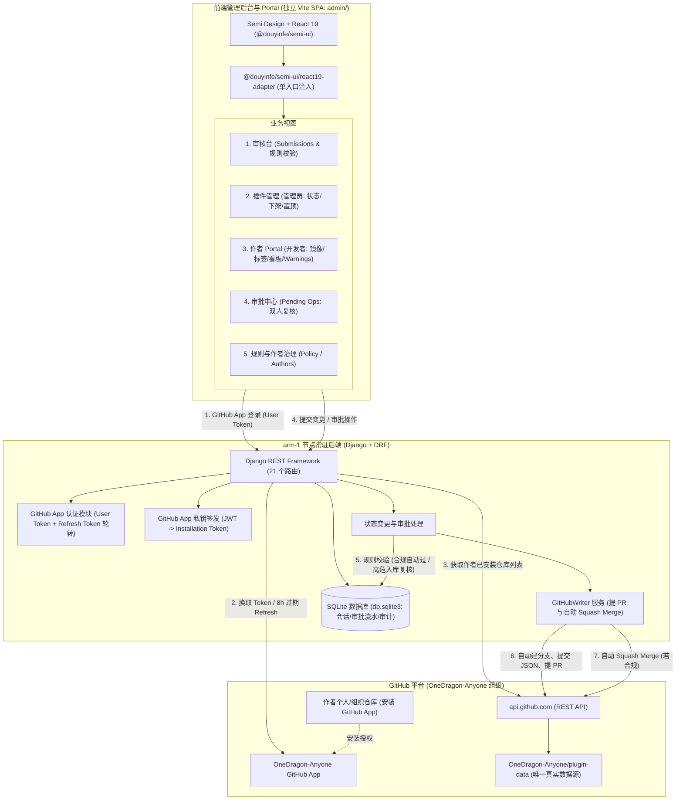

# 插件管理后台与开发者 Portal 技术设计

- **需求来源**：Issue [Z0D-3] / [Z0D-9]
- **核心决策**：认证选用组织级 GitHub App，权限派生自 GitHub 仓库权限；数据变更通过 PR 写入 `plugin-data` 仓库；作者 Portal 纳入二期范围；后端采用 Django + DRF，前端采用独立 Vite SPA（Semi Design），不修改公开静态站代码。
- **设计负责人**：Architect
- **状态**：待评审
- **文档路径**：`docs/design/Z0D-3/design.md`

---

## 1. 现状与设计决策

### 1.1 现状分析
`plugin-market` 前端基于 Astro 7.x 构建为静态站点（`astro.config.mjs` 中配置 `output: "static"`），客户端组件使用 React 19 和 Fluent UI 9 渲染，部署在 GitHub Pages。数据源托管于 `OneDragon-Anyone/plugin-data` 仓库。

```text
┌────────────────────────────────────────────────────────────────────────┐
│                        现有架构数据与控制链路                            │
├─────────────────┬──────────────────────────────────────────────────────┤
│ 页面呈现与交互   │ Astro (SSG) + React Fluent UI (@/components/fluent)   │
│                 │ 路由：/ (市场)、/submission (提交)、/policy、/api-docs │
├─────────────────┼──────────────────────────────────────────────────────┤
│ 数据源与存储     │ 静态 JSON API (public/api/v1/plugins.json & stats)    │
│                 │ 数据仓元数据 (OneDragon-Anyone/plugin-data)            │
├─────────────────┼──────────────────────────────────────────────────────┤
│ 收录与审核链路   │ GitHub Issue 提交申请 ([submission])                  │
│                 │ GitHub Actions (reusable-submission-bot.yml) 触发    │
│                 │ 校验脚本：scripts/lib/validator.ts 调用 Python 3.11   │
│                 │ 扫描脚本：scripts/scan/* (静态/依赖/恶意安全扫描)     │
│                 │ 结果反馈：Issue 评论 + 自动打标 (pending/rejected 等)  │
├─────────────────┼──────────────────────────────────────────────────────┤
│ 构建发布流程     │ scripts/build.ts 聚合生成 public/api/v1/ 静态索引     │
└─────────────────┴──────────────────────────────────────────────────────┘
```

### 1.2 核心决策

1. **认证选用 GitHub App**：
   - 作者在 Portal 中维护名下仓库的镜像与标签，需要验证仓库所有权。
   - GitHub App 安装到仓库的操作本身即代表管理授权，无需在后端单独实现复杂的仓库权限校验逻辑，授权范围也严格限制在已选仓库内。
   - GitHub App 创建在 `OneDragon-Anyone` 组织下。
2. **权限与审核机制**：
   - 权限跟随仓库授权：作者将 App 安装到指定仓库后，Portal 即可读取并展示对应插件；组织仓库需组织拥有者批准。
   - 无独立账号系统：直接以 GitHub 仓库管理员权限为准，权限变更时 Portal 自动同步。
   - 审核聚焦规则校验：检查垃圾信息、规范合规性、保留 ID 与防抢注，不进行人工代码审查；符合规则自动合并，异常情况转人工复核。
   - 覆盖完整生命周期：定义提交待审、在架、驳回、暂停、废弃、移除等状态，各状态对应明确的数据语义与构建表现。
3. **数据写入严格通过 PR 完成**：
   - 所有变更均通过 GitHub PR 写入 `plugin-data` 仓库，不直接提交到主分支。
   - 以 Git 提交历史作为审计基准，数据库记录仅作为操作流水使用；数据不一致时以 Git 为准。
   - 由服务端判断合并方式：合规变更自动 Squash Merge，高风险操作进入双人复核。
4. **作者 Portal 纳入二期范围**：
   - 限定作者可编辑字段：仅允许修改 `tags`、`mirror`、`extraRisk`。
   - 核心字段（`status`、`pinned`）仅限管理员修改；抓取字段（Release、包大小、Readme）为只读。
   - 提供可视化看板：作者可查看名下插件状态、构建警告信息（warnings）及安装下载趋势。
5. **后端采用 Django + DRF**：
   - 用于承载 21 个 REST API、Token 轮转、审批记录与审计流水。
   - 使用 Django 自带的 ORM 数据迁移、Serializer 参数校验及权限拦截能力，减少基础功能开发量。
6. **前端采用独立 Vite SPA（Semi Design）**：
   - 在独立目录 `admin/` 下使用 React 19 和 `@douyinfe/semi-ui` 开发，通过单一入口注入适配器。
   - 现有公开站（Astro + Fluent UI + Tailwind）的代码与配置保持不变。

---

## 2. 非目标

1. **不做人工源码审计**：仅校验元数据规范、ID 合规性与安全扫描结果，不开展人工源码审查。
2. **数据库不作为插件元数据的主存储**：插件元数据仍保存在 `plugin-data` Git 仓库中。Django 仅存储认证凭证、Token 映射、审批记录与审计日志。
3. **不修改公开静态站**：公开站（Astro、Fluent UI、Tailwind、GitHub Pages）保持独立，不调整其代码与构建配置。
4. **作者不直接修改核心元数据**：作者端不可自行修改 `status`、`pinned` 及构建生成的 `releases`。

---

## 3. 详细设计

### 3.1 系统架构



---

### 3.2 身份认证与审核机制

#### 3.2.1 仓库管理权限判定
GitHub App 安装在 `OneDragon-Anyone` 组织下。作者提交或管理插件前，需在 GitHub 将该 App 安装至插件源码仓库（选择 "Only select repositories"）。

判定流程如下：
1. 后端调用 `GET /user/installations` 获取当前登录用户的全部安装实例。
2. 遍历调用 `GET /user/installations/{installation_id}/repositories` 获取其授予管理权的仓库列表。
3. 作者在 Portal 仅可查看和编辑上述仓库对应的插件。若作者在 GitHub 被取消仓库管理员身份，该仓库不会出现在安装列表中，Portal 权限随即失效，后端无需单独维护仓库权限映射。

#### 3.2.2 角色划分
系统不设立独立账号体系，基于 GitHub 账号（`github_id`、`login`）识别用户：
- **管理员**：通过环境变量 `ADMIN_USERS` 配置白名单用户名（如 `alice,bob`）。管理员可访问审核台、全局插件管理、下架、作者封禁及全局策略配置（Policy）。
- **插件作者**：拥有至少一个已安装该 GitHub App 的仓库。登录后可进入 Portal 查看并管理名下插件。

#### 3.2.3 规则校验与分流审批
插件收录与变更采用规则校验结合自动化扫描的机制：
- **规则校验项**：包体积不超过 `maxZipBytes`、封面图片合规、Manifest 包含必填字段、标签符合 `TAG_PATTERN` 且不超过 8 个、插件 ID 符合命名正则且不在 `reservedIds` 清单中、仓库未被封禁。
- **安全扫描项**：静态敏感 API 检测、依赖分析与恶意模式匹配。
- **审批分流**：
  - **自动审批并合并**：规则校验通过且无安全告警的作者自维护字段变更（`tags`、`mirror`、`extraRisk`），由服务端通过 `GitHubWriter` 自动创建分支、提交 JSON、创建 PR 并自动 Squash Merge。
  - **转入人工复核**：触发高危扫描、插件 ID 冲突、修改状态至 `suspended` 或 `removed`、作者封禁、修改全局 Policy 等操作，写入 `PendingOp` 记录，由双人复核（Maker-Checker）审批后执行。

#### 3.2.4 插件生命周期与状态映射

| 阶段 | 数据状态 | 说明 | 构建表现 |
| :--- | :--- | :--- | :--- |
| 申请中 | pending | 待审核，处于 Issue/PR 或待审批记录中，未写入正式目录 | 不参与构建 |
| 正常在架 | listed | 正常上架 | 写入 `search-index.json` 和 `plugins.json`，可正常搜索 |
| 审核拒绝 | rejected | 申请被拒绝，关闭 PR 并回复说明原因 | 不入库 |
| 暂停服务 | suspended | 因违规或维护暂时暂停，保留 ID 绑定防止抢注 | 从 `search-index.json` 剔除；在 `plugins.json` 中标记为停用 |
| 废弃归档 | deprecated | 插件已废弃，不推荐新用户使用 | 写入搜索索引与列表，展示废弃提示 |
| 隐藏 | hidden | 不在公开列表中推荐，仅可通过直链访问和下载 | 从 `search-index.json` 排除 |
| 彻底移除 | removed | 彻底下架，数据保留但构建阶段完全跳过 | `scripts/build.ts` 忽略此记录，不输出到索引 |

---

### 3.3 认证与 Token 管理

#### 3.3.1 GitHub App 凭证配置
- 所属组织：`OneDragon-Anyone`
- 凭证配置（通过 arm-1 环境变量注入，不提交至 Git 或打包进镜像）：
  - `GITHUB_APP_ID`：GitHub App ID
  - `GITHUB_APP_CLIENT_ID`：OAuth Client ID
  - `GITHUB_APP_CLIENT_SECRET`：OAuth Client Secret
  - `GITHUB_APP_PRIVATE_KEY`：GitHub App 私钥（RSA PEM 格式，用于生成 App JWT 并换取 Installation Token）
  - `GITHUB_APP_WEBHOOK_SECRET`：Webhook 签名校验密钥（可选）

#### 3.3.2 Token 生命周期与刷新机制
GitHub App 的 User-to-Server Token 有效期为 8 小时，同时返回有效期为 6 个月的 `refresh_token`：
- **换票请求**：前端传回授权 `code`，后端请求 `https://github.com/login/oauth/access_token` 获取 `access_token`、`expires_in`、`refresh_token` 与 `refresh_token_expires_in`。
- **存储与会话**：Django 将 Token 加密后保存在 SQLite 中，向前端签发 Django REST Token 或 JWT。
- **自动刷新**：在 Token 到期前 5 分钟内，使用 `refresh_token` 换取新令牌：
  ```python
  def ensure_valid_token(user_token_record):
      if now() >= user_token_record.expires_at - timedelta(minutes=5):
          resp = requests.post("https://github.com/login/oauth/access_token", data={
              "client_id": settings.GITHUB_APP_CLIENT_ID,
              "client_secret": settings.GITHUB_APP_CLIENT_SECRET,
              "grant_type": "refresh_token",
              "refresh_token": user_token_record.refresh_token
          }, headers={"Accept": "application/json"}).json()
          user_token_record.access_token = resp["access_token"]
          user_token_record.refresh_token = resp["refresh_token"]
          user_token_record.expires_at = now() + timedelta(seconds=resp["expires_in"])
          user_token_record.save()
      return user_token_record.access_token
  ```
- **数据仓库写入凭证**：服务端利用 `GITHUB_APP_PRIVATE_KEY` 签发 JWT，调用 `POST /app/installations/{data_repo_install_id}/access_tokens` 动态生成用于写入 `OneDragon-Anyone/plugin-data` 的短期 Installation Token（有效期 1 小时，权限限制为该仓库的 `contents:write` 与 `pull_requests:write`）。

---

### 3.4 数据写入流程

对 `plugin-data` 的数据修改遵循以下规则：
1. **不直接提交主分支**：每次改动创建临时分支 `portal/<action>-<id>-<ts>`，提交变更后向主分支创建 PR。
2. **Commit 格式规范**：
   ```text
   portal(<target>): update <id> by @<operator>

   Operator: @<github_username>
   Role: <admin|author>
   Action: <status_change|metadata_update|maker_checker_approval>
   Reason: <reason_string>
   Checker: @<checker_username> (if approved)
   Timestamp: <ISO-8601 UTC>
   ```
3. **合并处理**：
   - 作者修改自身插件的 `tags`、`mirror`、`extraRisk`：通过规则校验后，服务端创建 PR 并自动 Squash Merge，删除临时分支。
   - 管理员修改 `hidden` 或 `deprecated` 状态：服务端创建 PR 并自动 Squash Merge。
   - 管理员修改 `suspended`、`removed` 状态或封禁作者：写入 `PendingOp` 表，待 Checker 审核通过后，服务端创建 PR 并 Squash Merge。
4. **以 Git 为数据基准**：数据库中的记录作为操作流水使用。如果数据库与 Git 提交历史产生分歧，以 `plugin-data` 仓库中的 Git 历史为准。

---

### 3.5 作者 Portal 字段权限与功能

作者登录后进入 Portal 视图，字段权限定义如下：

| 字段 | 作者权限 | 管理员权限 | 处理规则 |
| :--- | :---: | :---: | :--- |
| `mirror` | 可修改 | 可修改 | 仅支持 CNB 或 Gitee 镜像源；校验通过后自动提 PR 并合并 |
| `tags` | 可修改 | 可修改 | 最多 8 个，需符合小写字母与连字符正则；校验通过后自动提 PR 并合并 |
| `extraRisk` | 可修改 | 可修改 | 仅可从预定义风险标签集合中选择；校验通过后自动提 PR 并合并 |
| `status` | 只读 | 可修改 | 包含 `suspended`、`removed` 等状态变更，需管理员操作 |
| `pinned` | 只读 | 可修改 | 置顶状态仅管理员可调整 |
| `readmeHtml`、`cover` | 只读 | 只读 | 构建脚本自动从 Release 和仓库抓取，不支持手动修改 |
| `warnings`、`release` | 只读 | 只读 | 由构建校验与安全扫描自动生成，不支持手动修改 |

**看板功能**：
- 查看名下插件的在架状态与历史审核记录。
- 查看构建系统生成的 `warnings` 详情（如版本号未递增、文件大小超标、哈希不匹配等）。
- 查看插件下载量走势、GitHub Star 数及安装趋势。

---

### 3.6 后端服务设计

#### 3.6.1 技术选型
- **API 承载**：使用 Django REST Framework（DRF）定义 21 个 RESTful 接口。
- **基础功能支持**：利用 Django 内置的 ORM、数据迁移、Serializer 参数校验和权限拦截机制。
- **模块解耦**：Git 操作封装为独立的 `GitHubWriter` 服务，与 Django 数据模型解耦。

#### 3.6.2 数据模型定义（`models.py`）
```python
from django.db import models

class UserProfile(models.Model):
    github_id = models.CharField(max_length=64, unique=True)
    username = models.CharField(max_length=128)
    avatar_url = models.URLField(blank=True)
    is_admin = models.BooleanField(default=False)
    created_at = models.DateTimeField(auto_now_add=True)

class GitHubToken(models.Model):
    user = models.OneToOneField(UserProfile, on_delete=models.CASCADE, related_name="token")
    access_token = models.CharField(max_length=255)
    refresh_token = models.CharField(max_length=255)
    expires_at = models.DateTimeField()
    updated_at = models.DateTimeField(auto_now=True)

class PendingOp(models.Model):
    STATUS_CHOICES = [
        ("pending", "Pending"),
        ("approved", "Approved"),
        ("rejected", "Rejected"),
        ("applied", "Applied"),
        ("failed", "Failed"),
    ]
    id = models.UUIDField(primary_key=True)
    target_type = models.CharField(max_length=32)      # 'plugin', 'policy', 'author'
    target_id = models.CharField(max_length=128)      # 如 'my_plugin'
    field = models.CharField(max_length=64)           # 如 'status', 'tags'
    before_value = models.TextField(null=True, blank=True)
    after_value = models.TextField()
    reason = models.TextField()
    maker = models.ForeignKey(UserProfile, on_delete=models.PROTECT, related_name="made_ops")
    checker = models.ForeignKey(UserProfile, on_delete=models.PROTECT, null=True, blank=True, related_name="checked_ops")
    checker_reason = models.TextField(blank=True)
    status = models.CharField(max_length=16, choices=STATUS_CHOICES, default="pending")
    pr_number = models.IntegerField(null=True, blank=True)
    pr_url = models.URLField(blank=True)
    commit_sha = models.CharField(max_length=64, blank=True)
    created_at = models.DateTimeField(auto_now_add=True)
    applied_at = models.DateTimeField(null=True, blank=True)
```

#### 3.6.3 RESTful API 清单

| 模块 | 方法与路径 | 权限 | 说明 |
| :--- | :--- | :--- | :--- |
| **认证与用户** | `GET /api/v1/auth/login-url` | 公开 | 获取 GitHub App OAuth 授权跳转 URL |
| | `POST /api/v1/auth/exchange` | 公开 | 接收授权码换取 Token，建立会话并同步用户所管仓库 |
| | `GET /api/v1/auth/me` | 登录用户 | 获取当前用户身份、管理员标志及授权仓库列表 |
| | `POST /api/v1/auth/logout` | 登录用户 | 注销当前会话 |
| **作者 Portal** | `GET /api/v1/portal/plugins` | 作者或管理员 | 获取名下管理的插件列表、状态及警告摘要 |
| | `GET /api/v1/portal/plugins/:id` | 仓库作者 | 获取指定插件详情、warnings 记录及统计数据 |
| | `POST /api/v1/portal/plugins/:id/metadata` | 仓库作者 | 修改 `tags`、`mirror`、`extraRisk`（校验通过后自动提交 PR 并合并） |
| | `POST /api/v1/portal/plugins/:id/recheck` | 仓库作者 | 重新触发对该仓库的安全与规则扫描 |
| **管理员审核台** | `GET /api/v1/admin/submissions` | 仅管理员 | 获取待审 Issue 列表及扫描结果 |
| | `POST /api/v1/admin/submissions/:issue/review` | 仅管理员 | 审核通过（创建收录 PR）或拒绝（关闭 Issue） |
| **管理员插件管理** | `GET /api/v1/admin/plugins` | 仅管理员 | 获取全量插件列表，支持筛选与搜索 |
| | `POST /api/v1/admin/plugins/:id/status` | 仅管理员 (Maker) | 变更插件状态；高危状态进入审批队列 |
| | `POST /api/v1/admin/plugins/:id/pin` | 仅管理员 | 切换插件置顶状态 |
| | `POST /api/v1/admin/plugins/:id/override` | 仅管理员 | 强制修改插件元数据 |
| **Maker-Checker** | `GET /api/v1/admin/ops` | 仅管理员 | 查询审批队列，支持根据状态过滤（`pending`、`applied`、`all`） |
| | `POST /api/v1/admin/ops/:id/review` | 仅管理员 (Checker) | 审批操作（校验 `maker != checker`，比对变更前数据基线后自动合并 PR） |
| **作者与规则治理** | `GET /api/v1/admin/authors` | 仅管理员 | 获取作者列表及提交统计 |
| | `POST /api/v1/admin/authors/:user/ban` | 仅管理员 (Maker) | 封禁作者（拉黑用户与仓库，需复核） |
| | `GET /api/v1/admin/policy` | 仅管理员 | 读取全局规则 `market/policy.json` |
| | `POST /api/v1/admin/policy` | 仅管理员 (Maker) | 修改全局规则（保留 ID、限流、大小限制，需复核） |
| **数据与运维** | `GET /api/v1/admin/dashboard` | 仅管理员 | 获取全网插件与提交数据看板 |
| | `POST /api/v1/admin/sync` | 仅管理员 | 手动触发 `plugin-data` 静态索引构建流水线 |

---

### 3.7 前端结构

#### 3.7.1 工程结构与依赖
- **目录位置**：仓库根目录下新建独立工程 `admin/`。
- **技术栈**：React 19、TypeScript、Vite、`@douyinfe/semi-ui`、`@douyinfe/semi-icons`。
- **React 19 适配**：在 `admin/src/main.tsx` 文件首行引入 `@douyinfe/semi-ui/react19-adapter`。
- **独立构建**：`admin/` 与公开站点完全隔离，公开站（Astro + Fluent UI + Tailwind）的代码与构建配置保持不变。

#### 3.7.2 路由结构
- `/login`：GitHub App 授权登录页。
- `/portal`：作者 Portal 视图：
  - 授权仓库插件列表与 App 安装引导；
  - 插件元数据编辑（`tags`、`mirror`、`extraRisk`）；
  - warnings 提示与使用数据图表。
- `/admin`：管理员后台（需在管理员白名单中）：
  - 审核台（Submissions）；
  - 插件管理与状态调整（Plugins）；
  - 审批中心（PendingOps 双人复核）；
  - 作者管理与全局策略（Authors & Policy）；
  - 数据统计（Dashboard）。

---

## 4. 受影响组件与文件清单

| 路径 / 模块 | 变更类型 | 说明 | 对公开站构建的影响 |
| :--- | :--- | :--- | :--- |
| `admin/` | 新增 | 独立的 Vite SPA，包含管理后台与作者 Portal（React 19 + Semi Design） | 无影响，公开站构建不涉及该目录 |
| `services/portal-backend/` | 新增 | Django + DRF 后端服务，负责 21 个 API、Token 认证轮转、审批记录与 Git PR 写入 | 无影响，后端为独立 Python 服务 |
| `services/portal-backend/Dockerfile` | 新增 | 后端 Docker 镜像定义（Python 3.12-slim），部署于 arm-1 节点 | 无影响 |
| `scripts/lib/market.ts`、`src/lib/types.ts` | 复用/参照 | 复用 `MarketStatus`、`MarketPolicy`、`MarketSourceEntry` 类型定义与校验规则 | 无改动 |
| `src/` | 无改动 | 保持现有 Astro + React Fluent UI + Tailwind 静态站点代码不变 | 无改动 |
| `scripts/build.ts` | 无改动 | 原生支持 `suspended` 状态标记与 `removed` 状态排除 | 无改动 |

---

## 5. 开发步骤

### 5.1 后端服务开发（`services/portal-backend/`）
1. **初始化 Django 项目与数据模型**：
   - 使用 `django-admin startproject` 创建项目，配置 SQLite 数据库；
   - 在 `models.py` 中定义 `UserProfile`、`GitHubToken`、`PendingOp`，执行数据迁移。
2. **实现 GitHub App 认证与 Token 自动轮转**：
   - 使用 `GITHUB_APP_PRIVATE_KEY` 签发 JWT；
   - 编写 OAuth 授权换票接口，实现过期自动使用 `refresh_token` 刷新的逻辑；
   - 调用 `GET /user/installations` 及 repositories 接口，获取用户具备管理权限的仓库列表。
3. **实现 `GitHubWriter` 写入服务**：
   - 基于 GitHub REST API 实现分支创建、文件提交、创建 PR 与 Squash Merge 逻辑。
4. **实现 DRF 接口与权限拦截**：
   - 编写 `IsRepoAdminOrManager` 权限类，验证用户是否对仓库拥有 GitHub App 安装权限；
   - 实现 Maker-Checker 审批接口：校验 `maker != checker`，比对变更前数据基线，执行数据更新。

### 5.2 前端开发（`admin/`）
1. **初始化项目脚手架**：
   - 创建 Vite + React 19 + Semi Design 项目；
   - 在 `admin/src/main.tsx` 首行引入 `@douyinfe/semi-ui/react19-adapter`。
2. **开发作者 Portal 视图**：
   - 实现插件列表展示、App 安装引导、Warnings 提示查看及 `tags`/`mirror` 编辑表单。
3. **开发管理员后台视图**：
   - 实现审核台、插件状态管理弹窗、双人审批界面（Maker-Checker 复核与理由记录）、全局规则与作者管理。

### 5.3 构建验证与部署
1. **验证公开站构建**：
   - 在根目录下运行 `pnpm check` 与 `pnpm build`，确认静态站点构建正常。
2. **部署后端容器**：
   - 构建 `portal-backend` Docker 镜像，挂载 SQLite 存储目录，配置 cloudflared 将流量代理至后端端口。

---

## 6. 验证方案

### 6.1 权限与字段控制验证
1. **仓库管理权限判定验证**：
   - 用户将 GitHub App 安装到仓库 A，未安装到仓库 B；
   - 登录 Portal，确认仅列出仓库 A 对应的插件；
   - 调用接口尝试修改仓库 B 的数据，确认返回 403 Forbidden。
2. **作者修改受限字段验证**：
   - 作者修改仓库 A 插件的 `mirror` 镜像源并提交；
   - 验证规则校验通过后，系统自动创建 PR 并完成 Squash Merge，变更写入 `plugin-data`。
3. **作者修改非权限字段拦截验证**：
   - 作者尝试修改 `status` 或 `pinned`，确认接口返回 400 或 403。

### 6.2 审批流程与 Token 刷新验证
1. **高危操作双人复核流程验证**：
   - 管理员 A 将插件状态变更为 `suspended`，确认系统生成 `PendingOp` 记录且状态为 `pending`；
   - 管理员 A 尝试执行批准操作，确认接口拒绝（`maker != checker` 返回 403）；
   - 管理员 B 填写理由并批准，确认数据基线校验通过后自动创建 PR 并合并；
   - 触发静态站构建，确认该插件从搜索索引中移除。
2. **Token 自动刷新验证**：
   - 手动将数据库中的 `expires_at` 修改为过期时间，调用 API，确认系统自动使用 `refresh_token` 换取新令牌，请求正常响应。

---

## 7. 风险与已知边界情况

| 风险 | 影响 | 应对措施 |
| :--- | :--- | :--- |
| GitHub App 私钥泄露 | 组织及数据仓库可能被未授权访问 | 1. 私钥仅通过环境变量注入运行环境，不进入代码仓库、镜像或日志；<br>2. App 写入权限严格限制在 `OneDragon-Anyone/plugin-data` 仓库。 |
| 仓库授权变更同步延迟 | 用户在 GitHub 卸载 App 后，Portal 可能存在短时间缓存未同步 | 1. 执行写操作前实时调用 GitHub API 校验仓库授权；<br>2. 后续可通过 GitHub App Webhook（`installation` 事件）实现实时失效。 |
| Git 并发写入冲突 | 多个并发修改可能导致 PR 合并冲突 | 1. 提交时携带目标文件最新的 blob SHA；<br>2. 提交失败时进行重试；<br>3. 若产生冲突，保留错误信息并通知管理员人工处理。 |
| 脚本注入风险 | 作者在描述或镜像地址中注入恶意脚本 | 前端禁止使用 `dangerouslySetInnerHTML`，所有字段均作为纯文本渲染。 |

---

## 8. 总结

本方案使用组织级 GitHub App 处理认证，通过 GitHub 仓库的管理权限确定插件管理范围，无需维护独立的账号与权限表。所有数据修改均通过 PR 提交至 `plugin-data` 仓库，以 Git 历史作为审计记录；合规变更自动合并，高风险变更走双人复核。系统由 Django + DRF 后端（提供 21 个 API）与独立的前端 Vite SPA（Semi Design）构成，现有公开静态站点保持原样，不作修改。
