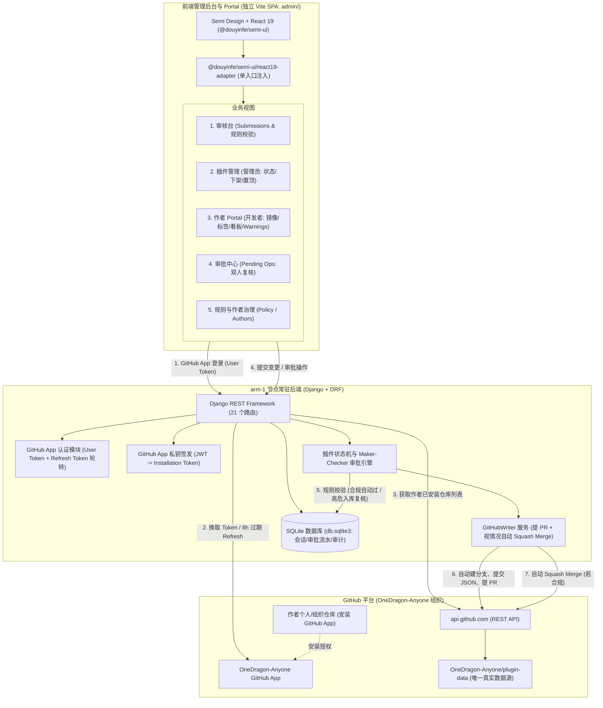

# 技术设计：插件管理后台与开发者 Portal 架构

- **需求来源**: Issue [Z0D-3] / [Z0D-9]
- **架构决策依据**: 认证选用组织级 **GitHub App**；身份与权限由 GitHub 仓库管理关系直接派生；写入严格走 PR 且以公开 Git 仓库为唯一基准；作者侧 Portal 纳入范围；后端采用 **Django + DRF**；前端采用独立目录 **Vite SPA + Semi Design**，公开站一行不改
- **设计负责人**: Architect
- **状态**: 待评审（G1 阶段最终案）
- **交付目标路径**: `docs/design/Z0D-3/design.md`

---

## 1. 理解：系统当前做什么与核心决策演进

### 1.1 现状架构分析
`plugin-market` 前端是基于 Astro 7.x 框架构建的**纯静态站点**（`astro.config.mjs` 配置 `output: "static"`），采用 React 19 + Fluent UI 9 进行客户端组件渲染，部署于 GitHub Pages。数据源托管于 `OneDragon-Anyone/plugin-data` 仓库。

```text
┌────────────────────────────────────────────────────────────────────────┐
│                        现有架构数据与控制链路                            │
├─────────────────┬──────────────────────────────────────────────────────┤
│ 页面呈现与交互   │ Astro (SSG) + React Fluent UI (@/components/fluent)   │
│                 │ 路由：/ (市场)、/submission (提交)、/policy、/api-docs │
├─────────────────┼──────────────────────────────────────────────────────┤
│ 数据源与存储     │ 静态 JSON API (public/api/v1/plugins.json & stats)    │
│                 │ 数据仓元数据 (OneDragon-Anyone/plugin-data)            │
├─────────────────┼──────────────────────────────────────────────────────┤
│ 收录与审核链路   │ GitHub Issue 提交申请 ([submission])                  │
│                 │ GitHub Actions (reusable-submission-bot.yml) 触发    │
│                 │ 校验脚本：scripts/lib/validator.ts 调用 Python 3.11   │
│                 │ 扫描脚本：scripts/scan/* (静态/依赖/恶意安全扫描)     │
│                 │ 结果反馈：Issue 评论 + 自动打标 (pending/rejected 等)  │
├─────────────────┼──────────────────────────────────────────────────────┤
│ 构建发布流程     │ scripts/build.ts 聚合生成 public/api/v1/ 静态索引     │
└─────────────────┴──────────────────────────────────────────────────────┘
```

### 1.2 架构决策要点

以下决策为本设计的技术基石，后续所有章节均以此为依据：

1. **认证全面切换为 GitHub App（彻底放弃 OAuth App）**：
   - 纳入作者侧 Portal 后，作者需要维护名下仓库的镜像与标签，必须强验证「该仓库属于我」。
   - **GitHub App 的「安装到仓库」动作本身即是管理员证明**。无需在服务端编写繁琐易漏的仓库权限校验代码，作者授权范围精准限制在所选仓库，杜绝越权。
   - GitHub App 创建在现有组织 `OneDragon-Anyone`（Organization）下。
2. **身份与审核的四条基本机制**：
   - **安装即授权**：作者在 GitHub 将 App 安装到仓库后，Portal 自动识别并呈现该插件；组织仓库需组织 owner 批准；
   - **无独立账号系统**：谁是 GitHub 仓库管理员谁管该插件，GitHub 权限变更，Portal 动态对齐；
   - **审核只审规则**：聚焦垃圾信息、合规性、保留 ID 与防抢注，不做耗时的人工代码审计；确立「视情况自动审批」标准（合规自动合并，可疑转人工）；
   - **状态机覆盖完整生命周期**：从提交待审、在架、驳回，到暂停、废弃、彻底移除，每个状态都有明确的业务语义与构建表现。
3. **写入模型：严格走 PR，以开放 Git 为唯一信任基准**：
   - 所有变更必须通过 GitHub PR 写入 `plugin-data`，严禁直接 Commit 到 master/main 分支；
   - Git 提交历史是不可篡改的唯一法定审计源，本地数据库流水仅作运营辅助，数据冲突以 Git 为准；
   - 自动合并逻辑由服务端后端判断：合规变更提 PR 后自动 Squash Merge，高危变更进入双人复核。
4. **作者侧 Portal 正式纳入（第二期范围明确）**：
   - 严格限定作者自助可编辑字段范围：仅限 `tags`、`mirror`、`extraRisk`；
   - 敏感字段（`status`、`pinned`）仅限管理员修改；抓取字段（Release、包大小、Readme）只读；
   - 作者享有完整的黑盒透视权：查看名下插件、Warnings 告警、安装与下载数据看板。
5. **后端技术栈定案：Django + DRF**：
   - 支撑 21 个 REST API、用户鉴权/Token 轮转、审批状态机与审计流水；
   - 利用 Django 成熟的 ORM 迁移、Serializer 数据校验与权限体系，大幅省去脚手架基础设施劳动。
6. **前端技术栈：独立 Vite SPA + Semi Design**：
   - 独立目录 `admin/`，采用 React 19 + `@douyinfe/semi-ui`，单一入口注入适配器；公开站（Astro + Fluent UI + Tailwind）**代码与配置一行不改**。

---

## 2. 非目标：明确不做的事

1. **不做深度代码审查**：收录与变更只审元数据规范、ID 合规与安全扫描命中，不设重量级人工源码审计流水线。理由是插件数量与提交频率远超人工审计容量，重审计会让整个流程不可持续。
2. **不接管 Git 业务数据至 Django ORM**：`plugin-data` 中的插件 JSON 依然保存在 Git 仓库中。Django ORM 仅管理认证凭证、refresh token、审批流水与审计日志，绝不在数据库中对插件元数据另建主库。
3. **不对公开静态站做任何破坏性侵入**：现有公开市场（Astro 纯静态、Fluent UI Win11 风格组件、Tailwind 样式、GitHub Pages 部署）保持 100% 独立，零改动。
4. **作者端严禁越权修改核心元数据**：作者严禁自助修改 `status`（下架/恢复）、`pinned`（置顶）以及构建时锁定的 `releases`，严守安全底线。

---

## 3. 建议改动：最小可行方案与技术架构设计

### 3.1 总体架构拓扑图



---

### 3.2 身份与审核的四条基本机制

#### 1. 安装即授权
- **实现原理**：GitHub App 安装在现有组织 `OneDragon-Anyone` 下。作者在提交或管理插件前，需在 GitHub 上将该 App 安装至其插件源码仓库（选择 "Only select repositories"）。
- **零权限判断代码**：
  - 后端调用 `GET /user/installations` 获取当前登录用户的全部安装实例；
  - 遍历调用 `GET /user/installations/{installation_id}/repositories` 获取其授予管理权的仓库列表；
  - 作者在 Portal 只能看到并编辑这些仓库对应的插件；若作者在 GitHub 上被移除管理员身份，安装列表中该仓库随之消失，Portal 权限即刻同步失效，**彻底无需在应用层编写易漏的权限判断逻辑**。

#### 2. 无独立账号体系
- 彻底摒弃传统账密与独立用户表。所有用户身份唯一基于 GitHub 账号（`github_id`, `login`）。
- **管理员判定**：环境变量 `ADMIN_USERS="alice,bob"` 白名单判定管理员身份；白名单内成员进入完整管理后台（审核台、全局插件管理、下架、作者封禁、全局 Policy）；
- **作者判定**：拥有至少一个已安装该 GitHub App 的仓库，登录后自动展示专属的「我的插件」Portal 视图。

#### 3. 审核只审规则，视情况自动审批
- 不实行耗费人力且不可持续的源码人工审计，改为规则化校验 + 自动化扫描：
  - **规则校验项**：包体积不超过 `maxZipBytes`、封面合规、Manifest 必填字段、标签符合 `TAG_PATTERN` 且不超过 8 个、插件 ID 符合正则且不在 `reservedIds` 保留清单中、仓库未被封禁；
  - **三类安全扫描**：静态安全扫描（敏感 API 检测）、依赖分析与已知恶意模式匹配；
- **视情况自动审批流**：
  - **自动过（Auto-Approve & Auto-Merge）**：规则校验 100% 通过且无扫描告警的作者自维护字段变更（`tags`, `mirror`, `extraRisk`），系统通过 `GitHubWriter` 自动创建分支、提交 JSON、提 PR 并立即自动 Squash Merge 入库；
  - **转人工（Escalate to Human）**：命中高危扫描、插件 ID 冲突/争议、涉及 `suspended` / `removed` 状态下架，或者涉及作者封禁与 Policy 全局修改，强制转入自建审批队列，走双人复核。

#### 4. 状态机与生命周期映射
状态机覆盖插件从提交到退役的完整生命周期，与 `plugin-data` 现有字段取值对应如下：

| 生命周期阶段 | `plugin-data` 状态 | 业务语义 | 构建与搜索表现 (`scripts/build.ts`) |
| :--- | :--- | :--- | :--- |
| **`pending`** | *（中间态/Issue/PR）* | 待审核申请 | 仍在 Issue/PR 或 `pending_ops` 中，未写入正式目录 |
| **`listed`** | **`listed`** | 正常在架 | 进入 `search-index.json`、`plugins.json`，搜索展示 |
| **`rejected`** | *（PR 关闭 / Issue 拒绝）* | 审核被拒 | 不入库，关闭 PR 并由机器人回帖说明原因 |
| **`suspended`** | **`suspended`** | 违规暂停/维护 | 从 `search-index.json` 剔除；`plugins.json` 标灰；**保留 ID 绑定防抢注** |
| **`archived`** | **`deprecated`** | 废弃归档 | 进入搜索与列表，但展示明显「已废弃」警示，不推荐新用户使用 |
| *（特殊）* | **`hidden`** | 隐藏直链 | 从搜索排除，不公开推荐，仅持直链可访问详情与下载 |
| *（特殊）* | **`removed`** | 彻底下架 | 构建彻底跳过（行 43：`entry.status === 'removed' continue`），完全抹除 |

---

### 3.3 认证体系与 Token 处理（GitHub App）

#### 3.3.1 GitHub App 密钥与配置
- **所属组织**：`OneDragon-Anyone`（Organization）；
- **凭证清单**（存放在 arm-1 环境变量，严禁进镜像与 Git）：
  - `GITHUB_APP_ID`：GitHub App 唯一 ID；
  - `GITHUB_APP_CLIENT_ID`：OAuth Client ID；
  - `GITHUB_APP_CLIENT_SECRET`：OAuth Client Secret；
  - `GITHUB_APP_PRIVATE_KEY`：GitHub App 私钥（RSA PEM 格式，用于生成 App JWT 进而换取 Installation Token）；
  - `GITHUB_APP_WEBHOOK_SECRET`：接收 App 安装/卸载 Webhook 校验（可选扩展）。

#### 3.3.2 令牌生命周期与 Refresh 机制
GitHub App 的 User-to-Server Token 默认具有 **8 小时过期时间**（附带 `refresh_token`，有效期 6 个月）：
- **换票请求**：前端回传 `code`，后端请求 `https://github.com/login/oauth/access_token` 获取 `{ access_token, expires_in, refresh_token, refresh_token_expires_in }`；
- **存储与会话**：Django 利用加密字段在 SQLite 中维护用户的 token 映射；对外向前端签发标准的 Django REST Token 或 JWT；
- **自动 Refresh 机制**（约 20 行核心逻辑）：
  ```python
  def ensure_valid_token(user_token_record):
      if now() >= user_token_record.expires_at - timedelta(minutes=5):
          resp = requests.post("https://github.com/login/oauth/access_token", data={
              "client_id": settings.GITHUB_APP_CLIENT_ID,
              "client_secret": settings.GITHUB_APP_CLIENT_SECRET,
              "grant_type": "refresh_token",
              "refresh_token": user_token_record.refresh_token
          }, headers={"Accept": "application/json"}).json()
          user_token_record.access_token = resp["access_token"]
          user_token_record.refresh_token = resp["refresh_token"]
          user_token_record.expires_at = now() + timedelta(seconds=resp["expires_in"])
          user_token_record.save()
      return user_token_record.access_token
  ```
- **服务端写数据仓凭证**：服务端利用 `GITHUB_APP_PRIVATE_KEY` 签发 JWT，调用 `POST /app/installations/{data_repo_install_id}/access_tokens`，动态生成专用于写入 `OneDragon-Anyone/plugin-data` 的短效 Installation Token（1 小时自动过期，权限细粒度限制为仅该仓 `contents:write` + `pull_requests:write`）。

---

### 3.4 写入模型：严格走 PR，以开放 Git 为基准

所有对 `plugin-data` 的数据修改必须遵守以下铁律：
1. **禁止直接 Commit 主分支**：任何改动必须动态检出临时分支 `portal/<action>-<id>-<ts>`，通过 Git Commit 记录变更，并向默认分支创建 PR。
2. **规范化 Commit 审计签名**：
   ```text
   portal(<target>): update <id> by @<operator>

   Operator: @<github_username>
   Role: <admin|author>
   Action: <status_change|metadata_update|maker_checker_approval>
   Reason: <reason_string>
   Checker: @<checker_username> (if approved)
   Timestamp: <ISO-8601 UTC>
   ```
3. **视情况自动审批与合并**：
   - 作者修改自身插件的 `tags` / `mirror` / `extraRisk`：经规则校验无误后，服务端提 PR 并立即自动 Squash Merge，删除临时分支；
   - 管理员触发 `hidden` / `deprecated`（选择跳过复核）：服务端提 PR 并自动 Squash Merge；
   - 管理员触发 `suspended` / `removed` 或封禁作者：强制写入 Django `PendingOp` 表，待 Checker 审批通过后，再由服务端调用 GitHub API 自动提 PR 并 Squash Merge。
4. **Git 是唯一真实数据基准**：
   - 数据库中的审批流水与状态仅为运营中间态；
   - 若数据库记录与 GitHub Git 历史不一致，**绝对以 Git 历史为唯一准绳**。

---

### 3.5 作者侧 Portal 范围与能力矩阵（第二期）

作者登录后进入「开发者 Portal」视图，严格根据字段性质施加权限隔离：

| 数据字段 | 作者能否修改 | 管理员能否修改 | 修改机制与流转规则 |
| :--- | :---: | :---: | :--- |
| **`mirror`（镜像源）** | **✅ 可以** | ✅ 可以 | 作者只能增加/修改 CNB 或 Gitee 镜像。合规校验通过后自动提 PR 并自动合并。 |
| **`tags`（分类标签）** | **✅ 可以** | ✅ 可以 | 最多 8 个，需满足小写字母与连字符正则。合规自动提 PR 并自动合并。 |
| **`extraRisk`（附加风险）** | **✅ 可以** | ✅ 可以 | 只能在合法风险标签集合中自愿声明。合规自动合并。 |
| **`status`（状态）** | **❌ 禁止** | **✅ 仅管理** | 包含 `suspended`（暂停）、`removed`（彻底下架）等，属于核心管理权。 |
| **`pinned`（置顶）** | **❌ 禁止** | **✅ 仅管理** | 首页置顶推荐权，仅管理员可调整。 |
| **`readmeHtml` / `cover`** | **❌ 禁止** | **❌ 禁止** | **构建时自动抓取**作者 Release 资源与仓库 Readme，人工禁止直接修改。 |
| **`warnings` / `release`** | **❌ 禁止** | **❌ 禁止** | 构建校验与安全扫描自动产出，双方均不可篡改。 |

**作者可视化看板能力**（解决以往完全黑箱问题）：
- 查看名下全部插件的在架状态与审核历史；
- 查看构建系统反馈的 `warnings` 详情（如版本号未递增、资源哈希不匹配、文件尺寸超标等）；
- 查看该插件的全网下载量走势、GitHub Star 数及安装趋势图表。

---

### 3.6 后端架构：Django + DRF 契约设计

#### 3.6.1 为什么选 Django + DRF
- **21 个 API 路由快速承载**：利用 DRF 的 `APIView` 与 `ViewSet` 快速产出规范的 RESTful 接口；
- **成熟的开箱即用基础设施**：内置数据库 ORM 迁移（SQLite）、声明式 Serializer 入参校验、标准 HTTP 状态码与异常响应格式化；
- **开箱即用鉴权类**：自定义 `GitHubAppAuthentication` 与 `IsRepoAdminOrManager` 权限拦截类；
- **架构解耦**：Git 写入（`GitHubWriter`）作为独立 Python Service 模块，纯粹处理 Git/PR 自动化，与 Django 业务模型保持正交。

#### 3.6.2 数据模型定义（`models.py`）
```python
from django.db import models

class UserProfile(models.Model):
    github_id = models.CharField(max_length=64, unique=True)
    username = models.CharField(max_length=128)
    avatar_url = models.URLField(blank=True)
    is_admin = models.BooleanField(default=False)
    created_at = models.DateTimeField(auto_now_add=True)

class GitHubToken(models.Model):
    user = models.OneToOneField(UserProfile, on_delete=models.CASCADE, related_name="token")
    access_token = models.CharField(max_length=255)
    refresh_token = models.CharField(max_length=255)
    expires_at = models.DateTimeField()
    updated_at = models.DateTimeField(auto_now=True)

class PendingOp(models.Model):
    STATUS_CHOICES = [
        ("pending", "Pending"),
        ("approved", "Approved"),
        ("rejected", "Rejected"),
        ("applied", "Applied"),
        ("failed", "Failed"),
    ]
    id = models.UUIDField(primary_key=True)
    target_type = models.CharField(max_length=32)      # 'plugin', 'policy', 'author'
    target_id = models.CharField(max_length=128)      # 如 'my_plugin'
    field = models.CharField(max_length=64)           # 如 'status', 'tags'
    before_value = models.TextField(null=True, blank=True)
    after_value = models.TextField()
    reason = models.TextField()
    maker = models.ForeignKey(UserProfile, on_delete=models.PROTECT, related_name="made_ops")
    checker = models.ForeignKey(UserProfile, on_delete=models.PROTECT, null=True, blank=True, related_name="checked_ops")
    checker_reason = models.TextField(blank=True)
    status = models.CharField(max_length=16, choices=STATUS_CHOICES, default="pending")
    pr_number = models.IntegerField(null=True, blank=True)
    pr_url = models.URLField(blank=True)
    commit_sha = models.CharField(max_length=64, blank=True)
    created_at = models.DateTimeField(auto_now_add=True)
    applied_at = models.DateTimeField(null=True, blank=True)
```

#### 3.6.3 21 个 RESTful API 契约全景清单

| 模块 | 方法与路径 | 访问权限 | 功能说明 |
| :--- | :--- | :--- | :--- |
| **认证与用户** | `GET /api/v1/auth/login-url` | 公开 | 获取 GitHub App OAuth 授权跳转 URL |
| | `POST /api/v1/auth/exchange` | 公开 | 换票、建立 Session、同步用户身份与安装仓库 |
| | `GET /api/v1/auth/me` | 登录用户 | 获取当前登录者身份、是否管理员及授权管理的仓库列表 |
| | `POST /api/v1/auth/logout` | 登录用户 | 注销会话并废弃前端 Token |
| **作者 Portal** | `GET /api/v1/portal/plugins` | 作者/管理 | 获取名下管理的插件列表、状态与告警摘要 |
| | `GET /api/v1/portal/plugins/:id` | 仓库管理作者 | 获取该插件详情、Warnings 历史与安装/下载趋势数据 |
| | `POST /api/v1/portal/plugins/:id/metadata` | 仓库管理作者 | **作者自助修改** `tags`, `mirror`, `extraRisk`（合规自动提 PR 并合并） |
| | `POST /api/v1/portal/plugins/:id/recheck` | 仓库管理作者 | 为作者仓库重新触发 `/recheck` 扫描检测 |
| **管理员审核台**| `GET /api/v1/admin/submissions` | 仅管理员 | 获取开放待审的 Issue 列表及三类扫描结果 |
| | `POST /api/v1/admin/submissions/:issue/review` | 仅管理员 | 审核通过（提收录 PR）或拒绝（关闭 Issue） |
| **管理员插件管理**| `GET /api/v1/admin/plugins` | 仅管理员 | 全网插件列表过滤、搜索与状态查询 |
| | `POST /api/v1/admin/plugins/:id/status` | 仅管理员 (Maker) | **变更插件状态（下架/恢复）**，高危强制进入审批队列 |
| | `POST /api/v1/admin/plugins/:id/pin` | 仅管理员 | 切换置顶状态 |
| | `POST /api/v1/admin/plugins/:id/override`| 仅管理员 | 管理员强制覆盖修改插件元数据 |
| **Maker-Checker**| `GET /api/v1/admin/ops` | 仅管理员 | 查询审批队列列表（`status=pending|applied|all`） |
| | `POST /api/v1/admin/ops/:id/review` | 仅管理员 (Checker)| **审批操作**（`maker != checker` 强核验、重新核验 `before`、自动 Merge） |
| **作者与规则治理**| `GET /api/v1/admin/authors` | 仅管理员 | 获取作者列表与提交统计 |
| | `POST /api/v1/admin/authors/:user/ban` | 仅管理员 (Maker) | 封禁作者（拉黑用户与 repoId，需复核） |
| | `GET /api/v1/admin/policy` | 仅管理员 | 获取全局规则 `market/policy.json` |
| | `POST /api/v1/admin/policy` | 仅管理员 (Maker) | 修改全局规则（保留 ID、限流、大小限制） |
| **数据与运维** | `GET /api/v1/admin/dashboard` | 仅管理员 | 管理端全网统计看板数据聚合 |
| | `POST /api/v1/admin/sync` | 仅管理员 | 手动触发 `plugin-data` 静态索引构建流水线 |

---

### 3.7 前端架构：独立 Vite SPA + Semi Design（`admin/`）

#### 3.7.1 独立 Vite SPA 架构规范
- **目录落点**：仓库根目录下新建独立工程 `admin/`；
- **技术栈**：React 19 + TypeScript + Vite + `@douyinfe/semi-ui` + `@douyinfe/semi-icons`；
- **React 19 完美适配**：在 `admin/src/main.tsx` 文件首行引入 `@douyinfe/semi-ui/react19-adapter`；
- **公开站零修改**：完全不引入 Tailwind，公开站（Astro + Fluent UI + Tailwind）**代码与配置一行不改**，构建完全独立解耦。

#### 3.7.2 视图组织与路由划分
- **/login**：GitHub App 授权登录页；
- **/portal**：**开发者 Portal 视图**（面向普通作者）：
  - 授权仓库插件列表、安装 App 引导；
  - 插件元数据自助编辑（`tags`、`mirror`、`extraRisk`）；
  - Warnings 警示查看与数据图表展示；
- **/admin**：**管理员视图**（仅白名单管理员可见）：
  - 审核台（Submissions）；
  - 插件管理与高危下架（Plugins）；
  - 审批中心（PendingOps：Maker-Checker）；
  - 作者治理与全局规则（Authors & Policy）；
  - 全网数据看板（Dashboard）。

---

## 4. 受影响组件与文件清单

| 路径 / 模块 | 变更类型 | 说明与职责 | 对公开站影响 (`pnpm build`) |
| :--- | :--- | :--- | :--- |
| `admin/` (完整目录) | **新增** | 独立的 Vite SPA 管理后台与开发者 Portal（React 19 + Semi Design） | **完全解耦，零影响**。公开站构建完全不触碰该目录。 |
| `services/portal-backend/` | **新增** | **Django + DRF 后端服务**：承载 21 个 API、GitHub App JWT/Refresh 认证、SQLite 审批模型、Git PR 写入服务 | **独立 Python 服务**，不进入前端静态打包。 |
| `services/portal-backend/Dockerfile` | **新增** | 后端 Docker 部署镜像文件（Python 3.12-slim），运行于 arm-1 | 独立容器。 |
| `scripts/lib/market.ts` / `src/lib/types.ts` | **复用/参照** | 复用现有的 `MarketStatus`, `MarketPolicy`, `MarketSourceEntry` 类型与校验规范 | 保持现有一致，无需改动。 |
| `src/` (公开站代码) | **无改动** | 保持现有 Astro + React Fluent UI + Tailwind 纯静态架构原样不变 | **零破坏，零修改**。 |
| `scripts/build.ts` | **无改动** | 现有构建脚本已原生支持 `suspended` 过滤与 `removed` 彻底排除 | **零破坏，零修改**。 |

---

## 5. 实现步骤：给 Dev 的具体开发步骤

### 阶段一：后端 Django + DRF 服务搭建 (`services/portal-backend/`)
1. **初始化 Django 项目与数据库模型**：
   - 使用 `django-admin startproject` 初始化项目，配置 SQLite 数据库；
   - 编写 `models.py`（`UserProfile`, `GitHubToken`, `PendingOp`）并执行 `makemigrations` 与 `migrate`。
2. **实现 GitHub App 认证与 Token 自动轮转**：
   - 封装 GitHub App JWT 生成逻辑（使用 `GITHUB_APP_PRIVATE_KEY` 签发）；
   - 编写 OAuth 回调 exchange 接口，实现 8 小时过期前自动 `refresh_token` 的轮转中间件；
   - 封装 `GET /user/installations` 与 repositories 查询，确定作者有权管理的仓库列表。
3. **实现 `GitHubWriter` PR 写入与自动合并服务**：
   - 基于 GitHub REST API 封装分支创建、文件 Commit、提 PR 以及 Squash Merge 逻辑。
4. **编写 21 个 DRF 视图与权限类**：
   - 编写 `IsRepoAdminOrManager`：校验用户是否对该仓库拥有 GitHub App 安装权限；
   - 编写 Maker-Checker 状态机视图：`maker != checker` 强校验、`before` 真实基线核对、双写更新。

### 阶段二：前端独立 Vite SPA 开发 (`admin/`)
1. **搭建独立 SPA 脚手架**：
   - 初始化 Vite + React 19 + Semi Design 项目；
   - 在 `admin/src/main.tsx` 首行注入 `@douyinfe/semi-ui/react19-adapter`。
2. **实现开发者 Portal 视图**：
   - 插件列表、Warnings 详情展示、`tags`/`mirror` 编辑表单、安装 App 引导。
3. **实现管理员后台视图**：
   - 审核台、插件下架/状态变更弹窗、审批中心（Maker-Checker 复核与理由录入）、全局规则与作者治理。

### 阶段三：构建解耦与环境部署
1. **验证公开站零破坏**：
   - 根目录下运行 `pnpm check` 与 `pnpm build`，确保 Astro 纯静态站完全不受影响。
2. **部署 arm-1 容器**：
   - 构建 `portal-backend` Docker 镜像，挂载 SQLite 存储卷，配置 cloudflared 代理到后端端口。

---

## 6. 验证方式：给 Tester 的验证计划

### 6.1 身份模型与权限隔离验证
1. **安装即授权验证**：
   - 作者账号将 GitHub App 安装到自己的仓库 A，未安装到仓库 B；
   - 登录 Portal，确认界面仅列出仓库 A 对应的插件，仓库 B 不可操作；
   - 作者尝试调用 API 直接修改仓库 B 的数据，确认后端鉴权类返回 `403 Forbidden`。
2. **作者自助修改人工字段验证**：
   - 作者修改仓库 A 插件的 `mirror` 镜像源，提交保存；
   - 验证规则校验通过后，服务端以 GitHub App 身份自动创建分支提 PR 并完成自动 Squash Merge；
   - 验证变更成功写入 `plugin-data` 且无人工干预。
3. **作者越权修改敏感字段拦截验证**：
   - 作者尝试修改 `status`（下架）或 `pinned`，确认接口直接报错拒绝（400/403）。

### 6.2 Maker-Checker 审批闭环验证
1. **高危下架双人复核流程**：
   - 管理员 A 将插件状态变更为 `suspended`，确认系统自动创建 `PendingOp`，状态为 `pending`；
   - 管理员 A 尝试自己批准，确认后端返回 `403 Forbidden`（`maker != checker`）；
   - 管理员 B 填写批准理由并确认，服务端校验 `before` 基线通过后自动提 PR 并完成合并；
   - 静态站构建后验证该插件从搜索索引中剔除。
2. **Token 自动轮转（Refresh Token）验证**：
   - 模拟 User Token 过期（调整数据库 `expires_at`），发起 API 请求，验证系统自动使用 `refresh_token` 换取新令牌且请求无感完成。

---

## 7. 风险与已知边界情况

| 风险项 | 潜在影响 | 架构防御与应对策略 |
| :--- | :--- | :--- |
| **GitHub App 私钥泄露** | 私钥泄露可导致整个组织和数据仓被越权访问。 | 1. 私钥仅以环境变量注入 arm-1 生产机，严禁写入 Git、镜像层或日志；<br>2. App 安装权限精确限制在 `OneDragon-Anyone/plugin-data` 单仓写入。 |
| **安装即授权的权限延迟** | 用户在 GitHub 卸载 App 后，Portal 端存在短时间缓存未及时同步。 | 1. 关键写操作前实时调用 GitHub API 校验安装归属；<br>2. 后续可配置 GitHub App Webhook（`installation` 事件）实现实时废止。 |
| **Git 并发写入冲突** | 多人或多作者同时提 PR 触发冲突。 | 1. 每次提交带最新 blob SHA；<br>2. 提 PR 失败自动重试；<br>3. 冲突时保留详细报错转管理员人工干预。 |
| **XSS 与文本注入风险** | 作者在描述或镜像中注入恶意脚本。 | 全站禁止 `dangerouslySetInnerHTML`，所有输出一律按纯文本节点渲染。 |

---

## 8. 结论与下一步（判门 G1）

本设计以组织级 **GitHub App** 为认证基础，把身份与权限判定交给 GitHub 的仓库管理关系直接派生，因此不需要维护独立的账号体系与授权表。写入一律经 PR 落到 `plugin-data`，Git 历史是唯一可信审计源；合规变更自动合并，可疑变更转人工复核。范围覆盖管理后台与作者侧 Portal，后端采用 **Django + DRF** 承载 21 个 API 与审批流，前端采用**独立 Vite SPA + Semi Design**，公开站一行不改。

设计文档已定稿提交，提请 Leader 审阅并进行 G1 判门。
