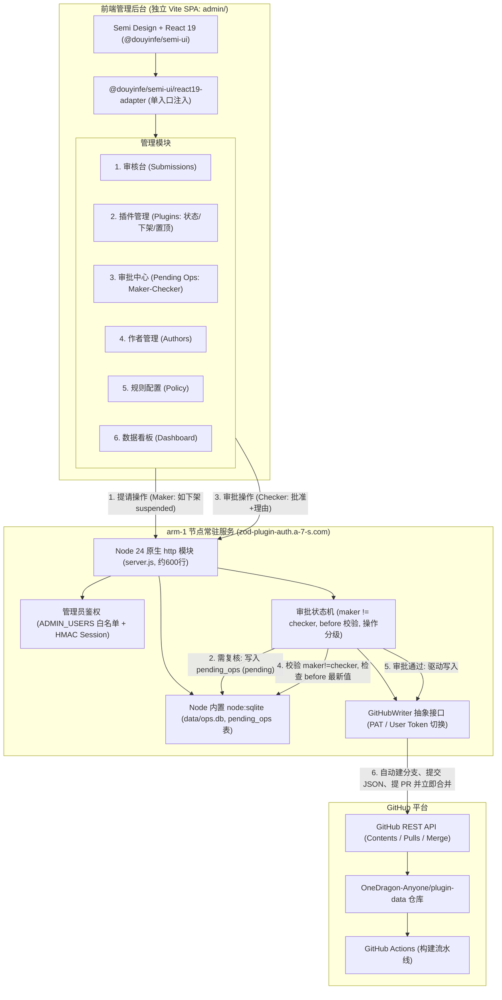

# 技术设计：插件管理后台架构（自建 Maker-Checker 审批 + 独立 Vite SPA + GitHub PR 写入模型）

- **需求来源**: Issue [Z0D-3] / [Z0D-9]
- **架构决策依据**: 人类拍板新增决策（涵盖自建 Maker-Checker 审批闭环、Node 24 内置 `node:sqlite` 存储、`GitHubWriter` 抽象与平滑切 Token、前端独立 Vite SPA + Semi Design，公开站一行不改）
- **设计负责人**: Architect
- **状态**: 待评审（G1 阶段修订案）
- **交付目标路径**: `docs/design/Z0D-3/design.md`

---

## 1. 理解：系统当前做什么与核心决策演进

### 1.1 现状架构分析
`plugin-market` 前端是基于 Astro 7.x 框架构建的**纯静态站点**（`astro.config.mjs` 配置 `output: "static"`），采用 React 19 + Fluent UI 9 进行客户端组件渲染，部署于 GitHub Pages。

```text
┌────────────────────────────────────────────────────────────────────────┐
│                        现有架构数据与控制链路                            │
├─────────────────┬──────────────────────────────────────────────────────┤
│ 页面呈现与交互   │ Astro (SSG) + React Fluent UI (@/components/fluent)   │
│                 │ 路由：/ (市场)、/submission (提交)、/policy、/api-docs │
├─────────────────┼──────────────────────────────────────────────────────┤
│ 数据源与存储     │ 静态 JSON API (public/api/v1/plugins.json & stats)    │
│                 │ 数据仓元数据 (OneDragon-Anyone/plugin-data)            │
├─────────────────┼──────────────────────────────────────────────────────┤
│ 收录与审核链路   │ GitHub Issue 提交申请 ([submission])                  │
│                 │ GitHub Actions (reusable-submission-bot.yml) 触发    │
│                 │ 校验脚本：scripts/lib/validator.ts 调用 Python 3.11   │
│                 │ 扫描脚本：scripts/scan/* (静态/依赖/恶意安全扫描)     │
│                 │ 结果反馈：Issue 评论 + 自动打标 (pending/rejected 等)  │
├─────────────────┼──────────────────────────────────────────────────────┤
│ 构建发布流程     │ scripts/build.ts 聚合生成 public/api/v1/ 静态索引     │
└─────────────────┴──────────────────────────────────────────────────────┘
```

### 1.2 人类拍板最新关键决策（本方案核心基石）
1. **审批闭环：自建 Maker-Checker，坚决不用 GitHub 分支保护**
   - 人类明确要求「不想再去 GitHub 点一次」。GitHub 原生 Require approvals 强依赖网页端点击与外部协作流，体验割裂。
   - 改为在后台系统内部自建 Maker-Checker 双人审批机制，审批流转与一键生效全部在后台完成，**全程无需打开 GitHub 网页**。
2. **存储方案：SQLite 单文件**
   - 采用 **Node 24 内置 `node:sqlite`** 单文件存储运维审批队列（`pending_ops`）。
   - 该方案严格遵守「不引入业务数据库」的约束：不复制 `plugin-data` 的插件元数据，审批表仅维护全新的内部运营流水，以 Git 历史作为最终唯一真实数据源。
3. **权限模型与写入抽象**
   - 进后台 2-3 人，完全信任，**权限相同不分级**（数据结构预留 `role` 字段，暂不启用差异）。
   - 写入层解耦抽象 `GitHubWriter` 接口，支持「服务端 PAT」与「管理员个人 Token」两种实现，通过环境变量平滑切换。第一期使用服务端 PAT。
4. **前端技术栈：独立 Vite SPA + Semi Design（公开站一行不改）**
   - 人类指定采用 **Semi Design（`@douyinfe/semi-ui`）+ React 19**。
   - 为彻底规避 Astro 多 island 无法统一加载 React 19 适配器，以及 Tailwind preflight 全局重置样式污染 Semi 组件的痛点，**管理后台独立成 Vite SPA（目录 `admin/`）**。
   - 公开站（Astro + Fluent UI + Tailwind）**代码与配置一行不改**，实现物理级解耦与零破坏。
5. **后端技术栈保持极简**
   - 不引入 Django 或 Axum。Node 原生标准库 + 内置 `node:sqlite` 即可满足约 15 个路由需求，预估代码量约 600 行，极低运维面积与资源消耗。

---

## 2. 非目标：明确不做的事

1. **不使用 GitHub 原生分支保护与网页审核**：坚决排除在 GitHub 网页点 PR Approve 的交互。
2. **不复制插件业务数据至本地数据库**：SQLite 仅用于审批操作流水（`pending_ops`），插件元数据与规则配置仍以 `plugin-data` 仓库中的 JSON 为唯一真实来源。
3. **不对公开站做任何侵入性改动**：现有 Astro 静态站、Fluent UI 组件、Tailwind 配置、构建脚本（`pnpm build`）保持 100% 原样不变。
4. **不实现复杂的 RBAC 角色权限分级**：信任团队 2-3 人权限平权，不做精细菜单授权或分权，仅严格执行 `maker != checker` 双人制衡。
5. **第一期不做作者端功能**：彻底排除插件作者登录查看名下插件的界面，保持关注管理后台。

---

## 3. 建议改动：最小可行方案与技术架构设计

### 3.1 总体架构流向图



---

### 3.2 自建 Maker-Checker 审批机制与状态机

#### 3.2.1 审批流转全景
为保障敏感操作安全，同时避免跳转 GitHub 网页审批，系统建立全后台闭环的 Maker-Checker 机制：

```text
 [管理员 A (Maker)]                     [管理员 B (Checker)]
        │                                      │
   提交下架申请                                    │
(如: foo 插件 -> suspended)                       │
        │                                      │
        ▼                                      │
 [服务端 Maker 拦截]                            │
   检查操作等级:                                 │
   • 高危 (removed/suspended): 强制建单          │
   • 中低危 (hidden/deprecated): 按需复核        │
        │                                      │
        ▼                                      │
 写入 pending_ops 表 (status='pending')         │
        │                                      │
        └─────────────── 通知 / 列表展示 ────────>│
                                               │
                                          在后台查看详情
                                         (diff、申请人、理由)
                                               │
                                          点击「批准」并录入审核理由
                                               │
                                               ▼
                                      [服务端 Checker 拦截]
                                      1. 校验 maker_id != checker_id
                                         (相同则 403 强阻断)
                                      2. 校验 checker_reason 必填 (空理由 400)
                                      3. 校验 pending 状态 (防重复处理)
                                      4. 重新校验 before 实际值:
                                         (读取 plugin-data 确认未被其他人修改，
                                          不一致则 409 阻断并标 failed)
                                               │
                                               ▼
                                      [GitHubWriter 自动执行]
                                      1. 创建分支 admin/op-<id>-<ts>
                                      2. 提交更新 JSON (带审计签名)
                                      3. 创建 Pull Request
                                      4. 立即调用 GitHub API Merge PR
                                      5. 删除临时分支
                                               │
                                               ▼
                                      [双写审计收口]
                                      更新 pending_ops 表:
                                      status='applied', applied_at=NOW
                                      记录 pr_number 与 commit_sha
```

#### 3.2.2 审批状态机硬性要求
1. **服务端强制 `maker != checker`**：
   - 即使前端被篡改或直接调用 API，服务端在批准接口中强制检查：
     `if (op.maker_id === currentAdmin.username) return res.status(403).json({ error: "maker_cannot_be_checker" });`
2. **批准理由必填**：
   - 批准或拒绝操作必须录入理由（`checker_reason`），长度不得少于 5 个字符，空理由直接报 `400 Bad Request`。
3. **执行时强校验 `before` 基线值**：
   - 在执行写入前，服务端重新从 `plugin-data` 抓取目标文件（如 `market/plugins/<id>.json`），提取目标字段真实当前值并比对：
     `if (currentActualValue !== op.before) throw new ConflictError("target_changed_concurrently");`
   - 彻底防范盲目覆盖导致的并发脏写。
4. **操作分级机制**：
   - **高危操作（强制复核）**：插件彻底下架（`removed`）、暂停服务（`suspended`）、作者全局封禁（`ban_author`）。无论前端如何选择，后端强制进入 `pending_ops` 队列，必须等待另一名管理员批准。
   - **中低危操作（可配置免复核）**：插件隐藏（`hidden`）、插件标记废弃（`deprecated`）、更新标签（`tags`）、置顶切换（`pinned`）、配置镜像（`mirror`）。支持管理员在表单勾选「直接生效（跳过复核）」，由当前操作人一次性提 PR 并合并。
5. **双写审计一致性保障**：
   - **SQLite** 记录内部操作流水的瞬时态与审批全生命周期；
   - **Git 历史** 记录落地生效的真实内容；
   - 两者若发生极端不一致（如 SQLite 标记 applied 但 GitHub API 网络超时未合并成功），**一律以 GitHub Git 真实提交为准**；后台提供「重试/状态同步」运维指令。

---

### 3.3 存储设计：Node 24 内置 `node:sqlite` 单文件数据库

#### 3.3.1 技术选型优势
- **Node 24 原生支持**：使用 `import { DatabaseSync } from 'node:sqlite'`，无需 `better-sqlite3`（免 node-gyp C++ 编译风险与依赖体积），无需外部关系型数据库服务。
- **存储文件落点**：`services/oauth-bridge/data/ops.db`（持久化挂载于 arm-1 Docker 卷）。

#### 3.3.2 数据库表结构定义（DDL）
```sql
CREATE TABLE IF NOT EXISTS pending_ops (
  id TEXT PRIMARY KEY,                       -- 操作唯一 ID (UUID v4)
  target_type TEXT NOT NULL,                 -- 目标类型: 'plugin' | 'policy' | 'author'
  target_id TEXT NOT NULL,                   -- 目标标识: 如 'my_plugin', 'repo_123', 'policy'
  field TEXT NOT NULL,                       -- 变更字段: 'status' | 'tags' | 'bannedUsers' 等
  before_value TEXT,                         -- 变更前基线值 (JSON 或字面量字符串)
  after_value TEXT NOT NULL,                 -- 变更后目标值 (JSON 或字面量字符串)
  reason TEXT NOT NULL,                      -- Maker 申请理由
  maker_id TEXT NOT NULL,                    -- Maker 的 GitHub 用户名
  status TEXT NOT NULL,                      -- 状态: 'pending' | 'approved' | 'rejected' | 'applied' | 'failed'
  checker_id TEXT,                           -- Checker 的 GitHub 用户名
  checker_reason TEXT,                       -- Checker 审批理由
  pr_number INTEGER,                         -- 对应的 GitHub PR 编号 (若已建)
  pr_url TEXT,                               -- 对应的 GitHub PR 地址
  commit_sha TEXT,                           -- 合并后的 Git Commit SHA
  created_at TEXT NOT NULL,                  -- 创建时间 (ISO-8601 UTC)
  applied_at TEXT                            -- 生效时间 (ISO-8601 UTC)
);

CREATE INDEX IF NOT EXISTS idx_pending_ops_status ON pending_ops(status);
CREATE INDEX IF NOT EXISTS idx_pending_ops_target ON pending_ops(target_type, target_id);
```

---

### 3.4 写入层抽象：`GitHubWriter` 接口设计

#### 3.4.1 接口契约与实现解耦
为满足当前使用服务端 PAT，同时预留未来无缝切换个人 Token 的灵活性，写入层抽取统一的 `GitHubWriter` 接口：

```typescript
export interface WriteOperation {
  targetPath: string;            // 仓库相对路径, e.g. "market/plugins/foo.json"
  content: string;               // 变更后的完整文件内容 (UTF-8 字符串)
  commitMessage: string;         // 结构化提交日志
  prTitle: string;               // PR 标题
  prBody: string;                // 包含审计信息的 PR 描述
  fastMerge: boolean;            // 是否在提 PR 后立即自动合并
}

export interface WriteResult {
  branch: string;
  prNumber: number;
  prUrl: string;
  merged: boolean;
  commitSha?: string;
}

export interface GitHubWriter {
  readonly modeName: "server_pat" | "user_token";
  applyChange(op: WriteOperation, actorToken?: string): Promise<WriteResult>;
}
```

#### 3.4.2 两种实现类与切换策略
1. **`ServerPatWriter`（第一期默认实现）**：
   - 凭证来源：arm-1 节点环境变量 `PLUGIN_DATA_PAT`；
   - 权限范围：Fine-grained PAT 仅绑定 `OneDragon-Anyone/plugin-data` 仓，权限包含 `contents:write` 与 `pull_requests:write`；
   - 执行方式：以机器人/公共凭证身份建分支、提 PR，并调用 `PUT /repos/:owner/:repo/pulls/:number/merge` 执行 Squash Merge。
2. **`UserTokenWriter`（预留切换实现）**：
   - 凭证来源：从 Checker（或 Maker）的当前 Session 绑定的个人 OAuth Access Token 动态传入；
   - 执行方式：以具体管理员个人 GitHub 身份提交 Commit 与合并 PR，Git 提交历史直接记录该管理员 GitHub 头像与账号；
   - 切换方式：通过环境变量 `GITHUB_WRITER_MODE=pat|user_token` 控制服务端工厂类实例化，**业务代码与状态机无感切换**。

---

### 3.5 前端架构：独立 Vite SPA + Semi Design（`admin/`）

#### 3.5.1 独立 Vite SPA 架构决策依据
人类明确要求前端使用 Semi Design（`@douyinfe/semi-ui`），并指示将其独立成 Vite SPA。此举优雅化解了现有架构的两个严重技术阻碍：

| 潜在风险/技术坑 | 塞在现有 Astro 项目中的后果 | 独立 Vite SPA 方案的效果 |
| :--- | :--- | :--- |
| **React 19 适配器注入** | Semi 在 React 19 下必须在最外层入口执行 `import '@douyinfe/semi-ui/react19-adapter'`。Astro SSG 无全局 React 单一入口，每个 island 独立打包，漏引入一个组件页面直接报错白屏。 | **单文件主入口**（`admin/src/main.tsx`）顶部引一次适配器，全局所有 Semi 组件自动适配 React 19，永不遗漏。 |
| **Tailwind preflight 样式污染** | 现有站点全局加载了 Tailwind preflight，会将 `<button>`, `<input>`, `<table>` 等样式全部重置为纯透明无边框，严重破坏 Semi Design 的组件视觉层级；若关闭 preflight，公开站布局全局崩塌。 | **完全不引入 Tailwind**，管理后台独享 Semi 纯净的 CSS 变量主题体系，公开站样式与配置保持 100% 隔离。 |
| **构建与依赖解耦** | 管理后台的依赖（`@douyinfe/semi-ui`, `@douyinfe/semi-icons`）会加重公开站构建负担，引发打包配置冲突。 | 公开站打包（`pnpm build`）**一行代码不改**；管理端运行独立的 `pnpm --filter admin build`。 |

#### 3.5.2 前端工程目录结构
在仓库根目录下新建独立子项目 `admin/`：

```text
admin/
├── index.html                   # SPA 唯一 HTML 模板
├── package.json                 # 独立依赖配置 (semi-ui, vite, react 19)
├── vite.config.ts               # 独立 Vite 配置 (base: '/admin/', 代理后端端口)
├── tsconfig.json                # 独立 TS 规则
└── src/
    ├── main.tsx                 # ★ 入口: 首行 import '@douyinfe/semi-ui/react19-adapter'
    ├── App.tsx                  # 路由分发与 Semi Layout 框架
    ├── api/                     # 后端 API 请求客户端 (Bearer Session Token)
    ├── components/              # 业务组件
    │   ├── SubmissionsTab.tsx   # 审核台 (Table, Tag, Popconfirm)
    │   ├── PluginsTab.tsx       # 插件管理 (下架 Dialog, 状态变更 Form)
    │   ├── PendingOpsTab.tsx    # ★ 审批中心 (待审列表, Maker/Checker 动作)
    │   ├── AuthorsTab.tsx       # 作者管理 (封禁/解封)
    │   ├── PolicyTab.tsx        # 规则配置 (编辑 policy.json)
    │   └── DashboardTab.tsx     # 数据看板 (Card, Progress, 概览指标)
    └── styles/
        └── admin.css            # 管理后台局部辅助样式
```

#### 3.5.3 核心界面交互：下架申请与审批流程（Semi UI）
1. **下架/状态变更申请（Maker）**：
   - 在 `PluginsTab` 点击「变更状态」，唤起 Semi `Modal`；
   - 下拉框选择目标状态：`suspended` / `removed` / `hidden` / `deprecated` / `listed`；
   - 必填输入框：变更原因（用于审计）；
   - 若选择 `suspended` 或 `removed`，界面提示：「⚠️ 本操作属于高危动作，提交后将进入审批队列，需由另一位管理员复核通过方可生效」；
   - 提交调用 `POST /api/admin/plugins/:id/status`，后端创建 `pending_ops` 记录，页面提示：「申请已提交至审批中心，等待复核」。
2. **审批流转与生效（Checker）**：
   - 管理员进入 `PendingOpsTab`，表格列出所有 `status='pending'` 的申请；
   - 若当前登录用户为 Maker，界面的「批准」按钮展示为 Disable 状态，并附 Tooltip 说明「不能复核自己提交的操作」；
   - 另一位管理员（Checker）点击「通过复核」，唤起 Semi `Modal` 录入复核理由，点击确认；
   - 后端执行 `maker != checker` 校验与 `before` 基线核验，通过后驱动 `GitHubWriter` 自动建分支提 PR 并合并；
   - 页面实时刷新，状态变更为 `applied`，并展示 PR 链接与合并 Commit。

---

### 3.6 arm-1 后端接口与鉴权契约（Node 原生零依赖）

#### 3.6.1 架构与部署
- **实现文件**：`services/oauth-bridge/server.js`，基于 Node 24 原生标准库（`http`, `https`, `crypto`, `sqlite`），零第三方 npm 依赖。
- **预估代码规模**：约 600 行（路由 200 行 + SQLite 操作 30 行 + GitHubWriter 150 行 + 审批状态机 150 行 + 数据读取与工具 80 行）。
- **运行环境**：arm-1 节点 Docker 容器（`node:24-alpine`），仅监听 `127.0.0.1:3000`，由既有 cloudflared 隧道将 `zod-plugin-auth.a-7-s.com` 流量转发至本地端口。

#### 3.6.2 RESTful API 契约全景表

| 接口方法与路径 | 角色与鉴权 | 说明与行为 |
| :--- | :--- | :--- |
| `GET /health` | 公开 | 健康检查，返回服务状态与 uptime |
| `POST /api/auth/exchange` | 公开 | OAuth 授权码换票，验证 GitHub `ADMIN_USERS` 白名单，签发 HMAC-SHA256 Session Token |
| `GET /api/admin/me` | Admin Bearer | 查询当前登录管理员身份信息与会话状态 |
| `GET /api/admin/ops` | Admin Bearer | **查询审批队列**。Query: `?status=pending|applied|all`，返回 `pending_ops` 列表 |
| `POST /api/admin/ops/:id/review` | Admin Bearer | **审批操作（Checker）**。<br>Body: `{ "action": "approve" \| "reject", "reason": "审核理由" }`<br>服务端强校验 `maker_id != current_user`，空理由报 400，重验 `before` 值，驱动 GitHub 写入并更新状态 |
| `GET /api/admin/submissions` | Admin Bearer | 待审核插件列表（读取 GitHub 开放的 `submission` 标签 Issue 及扫描摘要） |
| `POST /api/admin/submissions/:issue/review`| Admin Bearer | 审核收录（通过则自动为数据仓提 PR，拒绝则关闭 Issue 并回帖） |
| `GET /api/admin/plugins` | Admin Bearer | 查询插件全量列表与当前状态（组合静态 API 与待审操作） |
| `POST /api/admin/plugins/:id/status` | Admin Bearer | **变更插件状态（Maker 触发）**。<br>Body: `{ "status": "suspended" \| "removed" \| ..., "reason": "理由", "skipReview": false }`<br>高危操作强转 `pending_ops` 待审；非高危且 `skipReview=true` 可直接驱动写入 |
| `POST /api/admin/plugins/:id/meta` | Admin Bearer | 修改插件标签 (`tags`)、额外风险 (`extraRisk`)、置顶 (`pinned`) 或镜像 (`mirror`) |
| `GET /api/admin/authors` | Admin Bearer | 作者列表与提交记录统计 |
| `POST /api/admin/authors/:username/ban` | Admin Bearer | **封禁/解封作者（Maker 触发）**。<br>高危操作，写入 `pending_ops` 待 Checker 复核 |
| `GET /api/admin/policy` | Admin Bearer | 读取全局规则配置（`market/policy.json`） |
| `POST /api/admin/policy` | Admin Bearer | 更新规则配置（保留 ID、限流、大小限制），生成待审操作或直接提 PR |
| `GET /api/admin/dashboard` | Admin Bearer | 看板数据聚合：在架总数、待审申请数、审批中操作数、下载与星标统计 |

---

## 4. 受影响组件与模块清单

| 模块 / 文件路径 | 变更类型 | 说明与职责 | 对公开站构建的影响 (`pnpm build`) |
| :--- | :--- | :--- | :--- |
| `admin/` (整个子目录) | **新增** | **独立的 Vite SPA 管理后台**：包含 `package.json`, `vite.config.ts`, React 19 + Semi UI 组件及状态管理 | **完全隔离，零影响**。公开站构建完全不触碰该目录。 |
| `admin/src/main.tsx` | **新增** | 前端单一入口文件，首行注入 `@douyinfe/semi-ui/react19-adapter` | 确保 Semi 与 React 19 全局兼容。 |
| `admin/src/components/PendingOpsTab.tsx` | **新增** | **自建审批中心组件**：展示待审操作流、Maker 身份识别、Checker 审批与理由录入 | 独立管理端组件。 |
| `services/oauth-bridge/server.js` | **新增/扩充** | **Node 24 原生常驻服务**：集成 REST 路由、`node:sqlite` 操作流、Maker-Checker 状态机与 `GitHubWriter` | **独立后端服务**，不参与前端打包。 |
| `services/oauth-bridge/github-writer.js` | **新增** | `GitHubWriter` 接口与 `ServerPatWriter` / `UserTokenWriter` 实现 | 解耦 Token 策略与 Git 提 PR / Merge 操作。 |
| `services/oauth-bridge/data/` | **新增** | SQLite 数据持久化目录（存放 `ops.db`） | 服务端私有运行时数据。 |
| `services/oauth-bridge/Dockerfile` | **新增** | 容器构建文件，基于 `node:24-alpine` | 部署于 arm-1。 |
| `src/` (公开站全部代码) | **无改动** | 保持 Astro + React Fluent UI + Tailwind 纯静态架构原样不变 | **零破坏，零修改**。 |
| `scripts/build.ts` | **无改动** | 现有构建已原生支持 `suspended` 过滤与 `removed` 彻底排除 | **零破坏，零修改**。 |

---

## 5. 实现步骤：给 Dev 的具体开发步骤

### 阶段一：后端 Node 24 原生服务与 Maker-Checker 实现 (`services/oauth-bridge/`)
1. **初始化 SQLite 与表结构**：
   - 引入 Node 24 内置 `node:sqlite`（`DatabaseSync`），在初始化时创建 `pending_ops` 表及索引。
2. **封装 `GitHubWriter` 抽象层**：
   - 编写 `github-writer.js`，实现分支创建、提交文件、创建 PR 与 Squash Merge 逻辑。
   - 封装环境变量工厂：根据 `GITHUB_WRITER_MODE` 自动实例化 `ServerPatWriter` 或 `UserTokenWriter`。
3. **编写 Maker-Checker 状态机与路由**：
   - 实现 `POST /api/admin/plugins/:id/status`：判定操作等级（高危强制写入 `pending_ops`）。
   - 实现 `POST /api/admin/ops/:id/review`：服务端硬校验 `maker != checker`、理由非空校验、`before` 真实值核对，审批通过后驱动 `GitHubWriter` 执行。
4. **鉴权与 Session 中间件**：
   - 完善 OAuth 换票流程，校验 GitHub `ADMIN_USERS`，生成 HMAC Session Token。

### 阶段二：独立 Vite SPA 管理后台开发 (`admin/`)
1. **脚手架与依赖搭建**：
   - 在 `admin/` 目录初始化 Vite + React 19 + TypeScript。
   - 安装 `@douyinfe/semi-ui`、`@douyinfe/semi-icons`。
   - 在 `admin/src/main.tsx` 首行统一导入 `@douyinfe/semi-ui/react19-adapter`。
2. **管理面板开发（Semi UI）**：
   - 搭建全局 Semi Layout 框架（Header + Nav + Content）。
   - 编写 `PendingOpsTab`：待审流水表格、查看变更 diff、审批 Dialog。
   - 编写 `PluginsTab`：插件列表、状态筛选、下架 Dialog（根据高危级别给出 Maker-Checker 复核提示）。
   - 编写 `SubmissionsTab`、`AuthorsTab`、`PolicyTab`、`DashboardTab`。
3. **联调配置**：
   - 配置 `vite.config.ts` 中的本地开发代理，指向 `http://127.0.0.1:3000`。

### 阶段三：构建解耦与环境部署
1. **公开站验证**：
   - 运行根目录 `pnpm check` 与 `pnpm build`，确保现有 Astro 静态站完全不受 `admin/` 目录影响。
2. **管理后台构建**：
   - 运行 `pnpm --filter admin build`，生成独立的静态产物 `admin/dist`。
3. **arm-1 容器化部署**：
   - 构建 `node:24-alpine` 镜像，挂载 `data/` 目录，配置环境变量启动。

---

## 6. 验证方式：给 Tester 的验证计划

### 6.1 核心业务闭环测试（Maker-Checker）
1. **高危下架双人复核全流程验证**：
   - 管理员 A 登录后台，选择某一在架插件，操作状态变更为 `suspended`，填写下架理由「违规暂停维护」，点击提交；
   - 验证后台提示「已提交审批队列」，查看 SQLite 数据库确认生成 `status='pending'`、`maker_id='A'` 的记录；
   - 管理员 A 在审批中心查看该申请，确认界面的「批准」按钮处于禁用状态，且无法调用 review 接口自批自审（直接发请求验证报 403）；
   - 管理员 B 登录后台，进入审批中心，点击「批准」并录入审核评语，确认提交；
   - 验证服务端调用 GitHub API 自动建分支提 PR 并完成 Merge，SQLite 表更新为 `status='applied'`；
   - 构建后验证该插件在 `search-index.json` 中被剔除，在 `plugins.json` 中被标记为 `suspended`。
2. **审批硬性限制边界验证**：
   - **空理由拦截**：管理员 B 批准时不填理由，确认接口返回 `400 Bad Request`，不执行写入；
   - **并发脏写拦截（`before` 核验）**：在管理员 A 提交申请后、管理员 B 批准前，若插件在 Git 上已被他人手动修改导致状态脱敏，管理员 B 点击批准时，系统比对 `before` 失败，返回 `409 Conflict`，拒绝盲目覆盖。
3. **操作分级验证**：
   - 操作 `hidden` 或 `deprecated` 并勾选免复核，确认单人即可直接提 PR 并合并生效；
   - 操作 `removed`，确认即使不勾选复核也被后端强制归入审批队列。

### 6.2 独立 Vite SPA 与前端技术栈验证
1. **React 19 适配器验证**：
   - 验证 `admin/src/main.tsx` 引入适配器后，所有 Semi 弹窗、下拉、表格在 React 19 下无任何控制台 Warning 或运行时报错。
2. **样式无冲突验证**：
   - 验证管理后台 Semi 按钮、输入框、表格边框排版完好，未受 Tailwind preflight 重置干扰；
   - 验证公开站（`/` 首页、`/plugins/[id]`）保持 Fluent UI 磨砂亚克力风格，排版与交互毫无变化。
3. **零破坏构建验证**：
   - 根目录下执行 `pnpm check` 与 `pnpm build`，验证 4 个公开页面编译输出耗时正常，零构建破坏。

---

## 7. 风险与已知边界情况

| 风险项 | 潜在影响 | 架构防御与应对策略 |
| :--- | :--- | :--- |
| **Maker 与 Checker 越权自审** | 操作人自己批准自己的下架申请，导致审批流流于形式。 | 服务端在 API 层做死校验：`maker_id === checker_id` 直接返回 403 Forbidden，绝不依赖前端界面拦截。 |
| **并发修改冲突 (Git SHA 不一致)** | 审批通过后执行合并时，远程分支产生冲突。 | 1. 每次提 PR 基于默认分支最新 HEAD；<br>2. 每次写入前比对文件最新 blob SHA；<br>3. 写入失败时标记操作为 `failed`，保留详细报错，允许管理员重试。 |
| **SQLite 单文件损坏或丢失** | arm-1 宿主机异常导致 `ops.db` 丢失。 | 1. 宿主机对 `data/ops.db` 每日定时增量备份；<br>2. 架构以 GitHub Git 提交历史为最终唯一信任源，即使 SQLite 丢失，已合并的插件状态与 Git Log 完好无损。 |
| **PAT 与管理后端权限滥用** | 后端持有 merge 权，若被渗透存在风险。 | 1. 服务仅绑定 `127.0.0.1:3000`，外网仅经 Cloudflare 隧道且受 Access/白名单保护；<br>2. PAT 最小权限仅限定单一数据仓；<br>3. 写入路径白名单锁死在 `market/plugins/*.json` 与 `market/policy.json`，禁止任意文件写。 |

---

## 8. 结论与下一步（判门 G1）

本技术设计方案已全面落实人类关于「自建 Maker-Checker 审批闭环」、「Node 24 内置 `node:sqlite`」、「`GitHubWriter` 抽象」与「独立 Vite SPA + Semi Design」的最新决策，彻底解决了免打开 GitHub 审批、样式隔离与 React 19 适配问题，公开站代码零改动。

设计文档已修订完成，提请 Leader 审阅并进行 G1 判门。
