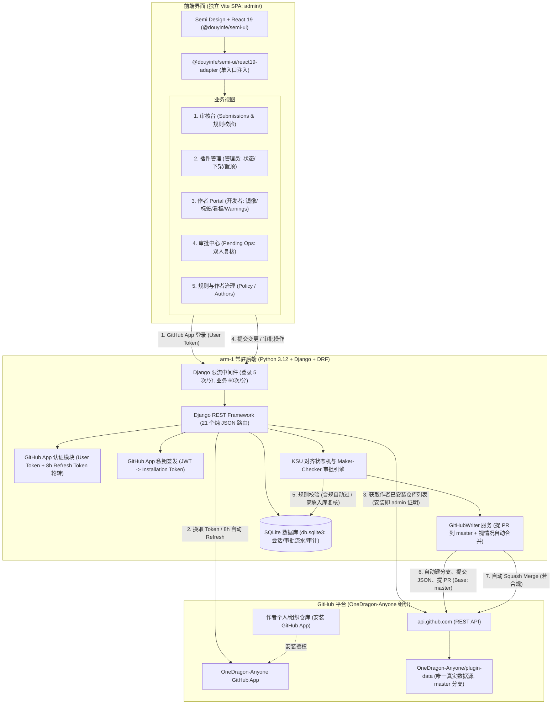

# 技术设计：插件管理后台与开发者 Portal 架构（KernelSU 模型与实测落地方案）

- **需求来源**: Issue [Z0D-3] / [Z0D-9]
- **架构决策依据**: 人类最终决策（参考 [KernelSU Portal](https://developers.kernelsu.org/docs/zh-CN/portal) 模型；组织级 GitHub App；写入严格走 PR 且以开放 Git 仓库为唯一基准；作者侧 Portal 纳入；后端选用 **Django + DRF**；前端选用独立目录 **Vite SPA + Semi Design**；包含 arm-1 真实环境实测数据与防 DDoS 限流加固）
- **设计负责人**: Architect
- **状态**: 待评审（G1 阶段终版）
- **交付目标路径**: `docs/design/Z0D-3/design.md`（推送到远程分支 `agent/architect/5eecd0b5f1ae`）

---

## 1. 理解：系统当前做什么与真实环境实测现状

### 1.1 现状架构分析
`plugin-market` 前端是基于 Astro 7.x 框架构建的**纯静态站点**（`astro.config.mjs` 配置 `output: "static"`），采用 React 19 + Fluent UI 9 进行客户端组件渲染，部署于 GitHub Pages。数据源托管于 `OneDragon-Anyone/plugin-data` 仓库。

```text
┌────────────────────────────────────────────────────────────────────────┐
│                        现有架构数据与控制链路                            │
├─────────────────┬──────────────────────────────────────────────────────┤
│ 页面呈现与交互   │ Astro (SSG) + React Fluent UI (@/components/fluent)   │
│                 │ 路由：/ (市场)、/submission (提交)、/policy、/api-docs │
├─────────────────┼──────────────────────────────────────────────────────┤
│ 数据源与存储     │ 静态 JSON API (public/api/v1/plugins.json & stats)    │
│                 │ 数据仓元数据 (OneDragon-Anyone/plugin-data，master 分支)│
├─────────────────┼──────────────────────────────────────────────────────┤
│ 收录与审核链路   │ GitHub Issue 提交申请 ([submission])                  │
│                 │ GitHub Actions (reusable-submission-bot.yml) 触发    │
│                 │ 校验脚本：scripts/lib/validator.ts 调用 Python 3.11   │
│                 │ 扫描脚本：scripts/scan/* (静态/依赖/恶意安全扫描)     │
│                 │ 结果反馈：Issue 评论 + 自动打标 (pending/rejected 等)  │
├─────────────────┼──────────────────────────────────────────────────────┤
│ 构建发布流程     │ scripts/build.ts 聚合生成 public/api/v1/ 静态索引     │
└─────────────────┴──────────────────────────────────────────────────────┘
```

### 1.2 arm-1 真实生产环境实测验证结论
维护团队已在目标生产节点（arm-1）对核心链路完成深度实测，得出以下不可违背的技术事实：

| 验证项 | 实测结果与生产事实 | 架构设计约束 |
| :--- | :--- | :--- |
| **App 归属** | `OneDragon-Anyone`（Organization 组织级应用） | 满足多协作者统一管理，权限集中。 |
| **App 权限集** | `contents: write`、`issues: write`、`metadata: read`、`pull_requests: write` | 精准满足提 PR、合并、打标与回帖需求，无多余提权。 |
| **安装范围 (Installation)** | `selected`，已精确覆盖 `plugin-data` 与 `plugin-market` | 访问范围被严格物理隔离在两个目标仓内，安全边界正确。 |
| **Installation Token** | 成功获取，有效期为标准的 1 小时 | 服务端必须按需用私钥生成 JWT 动态获取该 Token 写入数据仓。 |
| **写入链路连通性** | 建分支、提交变更 JSON、提 PR 全部实测通过 | 证明走 GitHub REST API 自动化 PR 写入模型 100% 可行。 |
| **凭证可用性** | `client_id` + `client_secret` 验证合法有效 | 用户授权码换票链路畅通。 |
| **数据仓默认分支** | **`plugin-data` 的默认分支是 `master`，绝非 `main`** | **所有建分支（Base Ref）、提 PR 的目标分支必须锁死为 `master`**。 |
| **arm-1 节点运行时** | **宿主机无 Node 运行时，仅具备 Python3 与 openssl** | **Django + DRF 方案完美适配宿主机**，无需破坏性安装 Node 运行时。 |
| **未安装访问行为** | 未安装 App 访问目标仓库直接返回 HTTP 401 | App 身份不能裸读仓库，必须经由 installation token 操作。 |
| **插件真实数据结构** | 当前 `market/plugins/` 下已有 13 个插件文件 | 单个条目以 `bagel.json` 为真实规范，字段结构严密对应。 |

---

## 2. 非目标：明确不做的事

1. **不做深度源码人工审计**：严格遵循 KernelSU 审核哲学，收录与变更只审元数据规范、ID 合规与安全扫描命中，不设重量级人工源码审计流水线。
2. **不把 Git 业务数据复制到 Django ORM**：`plugin-data` 中的插件 JSON 依然存放在 Git 仓库。Django ORM 仅管理会话、refresh token、审批流水与审计日志，绝不在本地数据库为插件另建主库。
3. **不对公开静态站做任何侵入性修改**：现有公开市场（Astro 纯静态、Fluent UI Win11 风格组件、Tailwind 样式、GitHub Pages 部署）保持 100% 独立，代码与配置一行不改。
4. **作者端严禁越权修改核心元数据**：作者严禁自助修改 `status`（下架/恢复）、`pinned`（置顶）以及构建时锁定的 `releases`，严守安全底线。
5. **不接入 Cloudflare Access**：认证完全基于 GitHub App OAuth 授权与系统自建的 Session/Token 拦截。

---

## 3. 建议改动：最小可行方案与技术架构设计

### 3.1 总体架构流向图



---

### 3.2 照抄 KernelSU 的四个核心机制落实

#### 1. 安装即授权（Installation is authorization）
- **机制与实现**：作者在 GitHub 上将 `OneDragon-Anyone` 组织下的 GitHub App 安装至其插件源码仓库（选择 "Only select repositories"）。
- **零权限判断代码**：
  - 后端调用 GitHub API `GET /user/installations` 获取当前登录用户的全部安装实例；
  - 遍历调用 `GET /user/installations/{installation_id}/repositories` 获取其授予管理权的仓库列表；
  - 作者在 Portal 只能看到并编辑这些仓库对应的插件；若作者在 GitHub 上被移除仓库管理员身份，安装列表中该仓库自动消失，Portal 权限即刻同步收回。**彻底无需在应用层编写易漏的权限判断逻辑**。

#### 2. 无独立账号体系（No Standalone Accounts）
- 彻底摒弃传统账密与独立用户表。所有用户身份唯一基于 GitHub 账号（`github_id`, `login`）。
- **管理员判定**：环境变量 `ADMIN_USERS="alice,bob"` 白名单判定管理员身份；白名单内成员进入完整管理后台（审核台、全局插件管理、下架、作者封禁、全局 Policy）；
- **普通作者判定**：拥有至少一个已安装该 GitHub App 的仓库，登录后自动展示专属的「我的插件」Portal 视图。

#### 3. 审核只审规则，视情况自动审批（Rule-based Audit & Auto-merge）
- 遵循 KSU 理念，不实行耗费人力且不切实际的源码人工审计：
  - **规则校验项**：包体积不超过 `maxZipBytes`、封面合规、Manifest 必填字段完整、标签符合 `TAG_PATTERN` 且不超过 8 个、插件 ID 符合正则且不在 `reservedIds` 保留清单中、仓库未被封禁；
  - **三类安全扫描**：静态安全扫描（敏感 API 检测）、依赖分析与已知恶意模式匹配；
- **视情况自动审批判定流**：
  - **自动过（Auto-Approve & Auto-Merge）**：规则校验 100% 通过且无扫描告警的作者自维护字段变更（`tags`, `mirror`, `extraRisk`），系统通过 `GitHubWriter` 自动创建分支、提交 JSON、提 PR 并立即自动 Squash Merge 入库；
  - **转人工（Escalate to Human）**：命中高危扫描、插件 ID 冲突/争议、涉及 `suspended` / `removed` 状态下架，或者涉及作者封禁与 Policy 全局修改，强制转入自建审批队列，走双人复核。

#### 4. 状态机对齐与映射
KernelSU 状态机与 `plugin-data` 现有状态天然对齐，映射关系如下：

| KernelSU 状态 | `plugin-data` 状态 | 业务语义与定位 | 构建与搜索表现 (`scripts/build.ts`) |
| :--- | :--- | :--- | :--- |
| **`pending`** | *（中间态/Issue/PR）* | 待审核申请 | 仍在 Issue/PR 或 `pending_ops` 中，未写入正式目录 |
| **`listed`** | **`listed`** | 正常在架 | 进入 `search-index.json`、`plugins.json`，搜索展示 |
| **`rejected`** | *（PR 关闭 / Issue 拒绝）* | 审核被拒 | 不入库，关闭 PR 并由机器人回帖说明原因 |
| **`suspended`** | **`suspended`** | 违规暂停/维护 | 从 `search-index.json` 剔除；`plugins.json` 标灰；**保留 ID 绑定防抢注** |
| **`archived`** | **`deprecated`** | 废弃归档 | 进入搜索与列表，展示明显「已废弃」警示，不推荐新用户使用 |
| *（特殊）* | **`hidden`** | 隐藏直链 | 从搜索排除，不公开推荐，仅持直链可访问详情与下载 |
| *（特殊）* | **`removed`** | 彻底下架 | 构建彻底跳过（行 43：`entry.status === 'removed' continue`），完全抹除 |

---

### 3.3 凭证管理、Token 轮转与写入链路（基于 master 分支）

#### 3.3.1 真实凭证存放规范（arm-1）
根据实测规范，生产凭证全部存放在宿主机特定目录，严格限制文件系统权限：
- **App 私钥路径**：`~/zzzod-admin/secrets/github-app.pem`（权限 `600`，由运行 Django 的用户只读）；
- **环境变量配置文件**：`~/zzzod-admin/secrets/app.env`（权限 `600`）：
  ```bash
  GITHUB_APP_ID="123456"
  GITHUB_APP_CLIENT_ID="Iv23..."
  GITHUB_APP_CLIENT_SECRET="9a8b..."
  GITHUB_APP_PRIVATE_KEY_PATH="/home/ubuntu/zzzod-admin/secrets/github-app.pem"
  ADMIN_USERS="alice,bob"
  SESSION_SECRET="super-secret-hmac-key"
  ALLOWED_ORIGIN="https://onedragon-anyone.github.io,http://localhost:4321,http://localhost:5173"
  ```
- **安全红线**：严禁将上述凭证写入 Git 仓库、Docker 镜像层或返回给前端。

#### 3.3.2 令牌生命周期与 8 小时 Refresh 机制
- **User-to-Server Token**：有效期 8 小时，配套 `refresh_token`（有效期 6 个月）。
- **Django 自动轮转逻辑**（每次请求拦截）：
  ```python
  from datetime import timedelta
  from django.utils.timezone import now
  import requests

  def ensure_valid_token(token_record):
      # 提前 5 分钟刷新，避免边缘超时
      if now() >= token_record.expires_at - timedelta(minutes=5):
          res = requests.post(
              "https://github.com/login/oauth/access_token",
              data={
                  "client_id": settings.GITHUB_APP_CLIENT_ID,
                  "client_secret": settings.GITHUB_APP_CLIENT_SECRET,
                  "grant_type": "refresh_token",
                  "refresh_token": token_record.refresh_token,
              },
              headers={"Accept": "application/json"},
              timeout=10,
          ).json()
          if "access_token" in res:
              token_record.access_token = res["access_token"]
              token_record.refresh_token = res["refresh_token"]
              token_record.expires_at = now() + timedelta(seconds=res["expires_in"])
              token_record.save(update_fields=["access_token", "refresh_token", "expires_at"])
      return token_record.access_token
  ```

#### 3.3.3 写入数据仓流程（锁定 `master` 分支）
服务端持有 App 私钥生成 JWT，换取 `OneDragon-Anyone/plugin-data` 的 Installation Token 后，执行以下写入流水：
1. **基准锁定**：获取 `OneDragon-Anyone/plugin-data` 的 `master` 分支最新 commit SHA（**绝不用 main**）；
2. **检出临时分支**：`refs/heads/portal/<action>-<id>-<timestamp>`；
3. **提交变更**：`PUT /repos/OneDragon-Anyone/plugin-data/contents/market/plugins/<id>.json`，携带文件最新 SHA，提交消息附带结构化审计；
4. **创建 PR**：Base 为 `master`，Head 为临时分支；
5. **视情况自动合并**：
   - 合规作者自维护修改：立即调用 `PUT /pulls/{number}/merge`（Squash），并删除临时分支；
   - 高危管理员操作（下架/封禁）：进入 `pending_ops` 双人复核流程。

---

### 3.4 插件真实数据结构与作者 Portal 范围

#### 3.4.1 插件 JSON 真实数据结构（以 `market/plugins/bagel.json` 为例）
当前数据仓已有 13 个在架插件，其真实文件数据结构为：
```json
{
  "id": "bagel",
  "repo": "Cora093/zzz-bagel-plugin",
  "repoId": 1440859224,
  "tags": [
    "automation",
    "route",
    "farming",
    "route-editor"
  ],
  "extraRisk": [],
  "status": "listed",
  "pinned": false,
  "review": {
    "issue": 17,
    "pr": 18,
    "submittedBy": "Cora093"
  }
}
```

#### 3.4.2 字段权限白名单矩阵

| 字段名 | 字段性质 | 作者权限 | 管理员权限 | 变更与生效流转规则 |
| :--- | :--- | :---: | :---: | :--- |
| **`mirror`** | 下载镜像源 | **✅ 允许修改** | ✅ 允许修改 | 作者仅能填写 CNB 或 Gitee 镜像仓库地址，校验通过后自动提 PR 并自动合并。 |
| **`tags`** | 分类标签 | **✅ 允许修改** | ✅ 允许修改 | 最多 8 个，满足小写/连字符正则，自动提 PR 并自动合并。 |
| **`extraRisk`** | 额外声明风险 | **✅ 允许修改** | ✅ 允许修改 | 允许作者主动上报附加风险标签（如 network, filesystem），自动合并。 |
| **`status`** | 上下架状态 | **❌ 严禁修改** | **✅ 仅管理员** | 包含 `suspended`（暂停）、`removed`（彻底下架），属于核心管理权，强制双人审批。 |
| **`pinned`** | 置顶展示 | **❌ 严禁修改** | **✅ 仅管理员** | 首页置顶推荐权，仅管理员可设置。 |
| **`repo` / `repoId`** | 仓库绑定 | **❌ 严禁修改** | **❌ 严禁修改** | 绑定作者真实仓库，防抢注，人工禁止随意篡改。 |
| **`review`** | 审核溯源信息 | **❌ 严禁修改** | **❌ 严禁修改** | 记录初次收录的 Issue、PR 编号及提交人，不可修改。 |
| **Release / Warnings** | 构建产物与警告 | **❌ 严禁修改** | **❌ 严禁修改** | **由构建脚本 `scripts/build.ts` 抓取自动生成**，双方只读。 |

**作者可视化看板能力**：
- 查看名下全部插件的在架状态与审核历史；
- 查看构建系统反馈的 `warnings` 详情（如版本号未递增、资源哈希不匹配、文件尺寸超标等）；
- 查看该插件的全网下载量走势、GitHub Star 数及安装趋势图表。

---

### 3.5 后端架构与 21 个 RESTful API 清单（Django + DRF）

#### 3.5.1 防 DDoS 与限流加固
用户明确要求后台具备防 DDoS 与防暴力破解能力：
- **限流中间件 / DRF Throttling 配置**：
  - **登录/换票接口**（`AnonRateThrottle`）：**每 IP 每分钟最多 5 次**。阻断频繁调用导致的 GitHub OAuth 上游封禁与凭证碰撞；
  - **业务读写接口**（`UserRateThrottle`）：**每用户每分钟最多 60 次**。阻断恶意脚本高频轮询或刷写接口；
  - 超出阈值时，接口统一返回 `429 Too Many Requests` 及 `Retry-After` 秒数。

#### 3.5.2 21 个 RESTful API 契约全景表

| 序号 | 模块 | 请求方法与路径 | 访问权限 | 说明与业务行为 |
| :---: | :--- | :--- | :--- | :--- |
| 1 | **认证** | `GET /api/v1/auth/login-url` | 公开 | 获取 GitHub App 授权跳转链接 |
| 2 | | `POST /api/v1/auth/exchange` | 公开 (限流 5/分) | 授权码换票，建立会话，拉取安装仓库列表 |
| 3 | | `GET /api/v1/auth/me` | 登录用户 | 获取当前登录者身份、是否管理员及有权管理的仓库 |
| 4 | | `POST /api/v1/auth/logout` | 登录用户 | 注销会话并销毁 Token |
| 5 | **作者 Portal**| `GET /api/v1/portal/plugins` | 仓库管理作者 | 获取名下管理的插件列表、状态与告警摘要 |
| 6 | | `GET /api/v1/portal/plugins/:id` | 仓库管理作者 | 获取该插件详情、Warnings 历史与安装/下载趋势数据 |
| 7 | | `POST /api/v1/portal/plugins/:id/metadata` | 仓库管理作者 | **作者自助修改** `tags`, `mirror`, `extraRisk`（自动 PR & Merge） |
| 8 | | `POST /api/v1/portal/plugins/:id/recheck` | 仓库管理作者 | 为作者仓库重新触发 `/recheck` 扫描检测 |
| 9 | **管理员审核台**| `GET /api/v1/admin/submissions` | 仅管理员 | 获取开放待审的 Issue 列表及三类扫描结果 |
| 10 | | `POST /api/v1/admin/submissions/:issue/review` | 仅管理员 | 审核通过（提收录 PR 到 master）或拒绝（关闭 Issue） |
| 11 | **管理员插件管理**| `GET /api/v1/admin/plugins` | 仅管理员 | 全网插件列表过滤、搜索与状态查询 |
| 12 | | `POST /api/v1/admin/plugins/:id/status` | 仅管理员 (Maker) | **变更插件状态（下架/恢复）**，高危强制进入审批队列 |
| 13 | | `POST /api/v1/admin/plugins/:id/pin` | 仅管理员 | 切换置顶状态 |
| 14 | | `POST /api/v1/admin/plugins/:id/override`| 仅管理员 | 管理员强制覆盖修改插件元数据 |
| 15 | **Maker-Checker**| `GET /api/v1/admin/ops` | 仅管理员 | 查询审批队列列表（`status=pending|applied|all`） |
| 16 | | `POST /api/v1/admin/ops/:id/review` | 仅管理员 (Checker)| **审批操作**（`maker != checker` 强核验、重新核验 `before`、自动 Merge） |
| 17 | **作者与规则治理**| `GET /api/v1/admin/authors` | 仅管理员 | 获取作者列表与提交统计 |
| 18 | | `POST /api/v1/admin/authors/:user/ban` | 仅管理员 (Maker) | 封禁作者（拉黑用户与 repoId，需复核） |
| 19 | | `GET /api/v1/admin/policy` | 仅管理员 | 获取全局规则 `market/policy.json` |
| 20 | | `POST /api/v1/admin/policy` | 仅管理员 (Maker) | 修改全局规则（保留 ID、限流、大小限制） |
| 21 | **数据与运维** | `GET /api/v1/admin/dashboard` | 仅管理员 | 管理端全网统计看板数据聚合 |

---

### 3.6 前端架构：独立 Vite SPA + Semi Design（`admin/`）

#### 3.6.1 独立 Vite SPA 架构规范
- **目录落点**：仓库根目录下新建独立工程 `admin/`；
- **技术栈**：React 19 + TypeScript + Vite + `@douyinfe/semi-ui` + `@douyinfe/semi-icons`；
- **React 19 适配机制**：在 `admin/src/main.tsx` 文件首行统一引入 `@douyinfe/semi-ui/react19-adapter`；
- **公开站零修改**：完全不引入 Tailwind，公开站（Astro + Fluent UI + Tailwind）**代码与配置一行不改**，构建完全独立解耦。

#### 3.6.2 视图组织
- **/login**：GitHub App 授权登录页；
- **/portal**：**开发者 Portal 视图**（面向普通作者）：
  - 授权仓库插件列表、安装 App 引导；
  - 插件元数据自助编辑（`tags`、`mirror`、`extraRisk`）；
  - Warnings 警示查看与数据图表展示；
- **/admin**：**管理员视图**（仅白名单管理员可见）：
  - 审核台（Submissions）；
  - 插件管理与高危下架（Plugins）；
  - 审批中心（PendingOps：Maker-Checker）；
  - 作者治理与全局规则（Authors & Policy）；
  - 全网数据看板（Dashboard）。

---

## 4. 受影响组件与文件清单

| 路径 / 模块 | 变更类型 | 说明与职责 | 对公开站影响 (`pnpm build`) |
| :--- | :--- | :--- | :--- |
| `admin/` (完整目录) | **新增** | 独立的 Vite SPA 管理后台与开发者 Portal（React 19 + Semi Design） | **完全解耦，零影响**。公开站构建完全不触碰该目录。 |
| `services/portal-backend/` | **新增** | **Django + DRF 后端服务**：承载 21 个 API、GitHub App JWT/Refresh 认证、SQLite 审批模型、Git PR 写入服务、防 DDoS 限流 | **独立 Python 服务**，不进入前端静态打包。 |
| `services/portal-backend/Dockerfile` | **新增** | 后端 Docker 部署镜像文件（Python 3.12-slim），运行于 arm-1 | 独立容器。 |
| `scripts/lib/market.ts` / `src/lib/types.ts` | **复用/参照** | 复用现有的 `MarketStatus`, `MarketPolicy`, `MarketSourceEntry` 类型与校验规范 | 保持现有一致，无需改动。 |
| `src/` (公开站代码) | **无改动** | 保持现有 Astro + React Fluent UI + Tailwind 纯静态架构原样不变 | **零破坏，零修改**。 |
| `scripts/build.ts` | **无改动** | 现有构建脚本已原生支持 `suspended` 过滤与 `removed` 彻底排除 | **零破坏，零修改**。 |

---

## 5. 实现步骤：给 Dev 的具体开发步骤

### 阶段一：arm-1 后端 Django + DRF 服务搭建 (`services/portal-backend/`)
1. **初始化 Django 项目与数据库**：
   - 初始化 Django 5.x 项目，配置 SQLite 数据库；
   - 编写 `models.py`（`UserProfile`, `GitHubToken`, `PendingOp`）并执行迁移。
2. **凭证加载与 JWT 换票模块**：
   - 读取 `~/zzzod-admin/secrets/github-app.pem` 签发 JWT；
   - 实现 OAuth 回调换票与 8 小时 Token 轮转机制；
   - 实现限流中间件（登录 5 次/分，业务 60 次/分）。
3. **实现 `GitHubWriter` 写入模块（锁定 master 分支）**：
   - 封装基于 `OneDragon-Anyone/plugin-data` 的 `master` 分支检出临时分支、提交 JSON、提 PR 与 Squash Merge 逻辑。
4. **实现 21 个 DRF 路由与权限类**：
   - 编写 `IsRepoAdminOrManager` 校验是否安装 GitHub App；
   - 编写 Maker-Checker 审批流（`maker != checker` 强校验、`before` 基线防并发覆盖）。

### 阶段二：前端独立 Vite SPA 开发 (`admin/`)
1. **搭建独立 SPA 脚手架**：
   - 初始化 Vite + React 19 + Semi Design 项目；
   - 在 `admin/src/main.tsx` 首行注入 `@douyinfe/semi-ui/react19-adapter`。
2. **实现开发者 Portal 视图**：
   - 授权仓库插件列表、Warnings 详情展示、`tags`/`mirror` 编辑表单、安装 App 引导。
3. **实现管理员后台视图**：
   - 审核台、插件下架/状态变更弹窗、审批中心（Maker-Checker 复核与理由录入）、全局规则与作者治理。

### 阶段三：构建解耦与环境部署
1. **验证公开站零破坏**：
   - 根目录下运行 `pnpm check` 与 `pnpm build`，确保 Astro 纯静态站完全不受影响。
2. **部署 arm-1 容器**：
   - 构建 `portal-backend` Docker 镜像，挂载凭证目录 `~/zzzod-admin/secrets/`，配置 cloudflared 代理到后端端口。

---

## 6. 验证方式：给 Tester 的验证计划

### 6.1 核心业务闭环测试（KernelSU 模型与真实环境）
1. **安装即授权与权限隔离验证**：
   - 作者账号将 GitHub App 安装到自己仓库 A，未安装到仓库 B；
   - 登录 Portal，确认界面仅列出仓库 A 对应插件，仓库 B 不可操作；
   - 作者尝试调用 API 直接修改仓库 B 的数据，确认后端鉴权类返回 `403 Forbidden`。
2. **作者自助修改人工字段（master 分支 PR 闭环）**：
   - 作者修改仓库 A 插件的 `mirror` 镜像源，提交保存；
   - 验证服务端以 GitHub App 身份自动基于 `master` 创建分支提 PR 并完成自动 Squash Merge；
   - 验证变更成功写入 `plugin-data` 的 `master` 分支且无人工干预。
3. **高危下架双人复核流程**：
   - 管理员 A 将插件状态变更为 `suspended`，确认系统自动创建 `PendingOp`，状态为 `pending`；
   - 管理员 A 尝试自己批准，确认后端返回 `403 Forbidden`（`maker != checker`）；
   - 管理员 B 填写批准理由并确认，服务端校验 `before` 基线通过后自动提 PR 并完成合并；
   - 静态站构建后验证该插件从搜索索引中剔除。
4. **防 DDoS 限流验证**：
   - 在 1 分钟内连续调用登录接口 6 次，验证第 6 次被 Django 拦截并返回 `HTTP 429 Too Many Requests`。

---

## 7. 风险与已知边界情况

| 风险项 | 潜在影响 | 架构防御与应对策略 |
| :--- | :--- | :--- |
| **私钥泄露风险** | 私钥泄露可导致整个组织和数据仓被越权访问。 | 1. 私钥仅存放在 `~/zzzod-admin/secrets/` 宿主机目录，权限限制 600，严禁入代码库或镜像；<br>2. App 权限严格最小化在单一数据仓与市场仓。 |
| **未安装访问 401 报错** | App 身份未获取 installation token 时无法直接读取仓库。 | 服务端在调用任何 GitHub API 前强制获取或刷新对应的 installation token。 |
| **Base 分支写错为 main 导致 PR 失败** | GitHub 返回 422 Invalid Base Branch。 | **全局硬编码 Base 分支为 `master`**，与实测事实严格保持一致。 |
| **高频请求导致上游 GitHub Rate Limit 耗尽** | GitHub App 安装 Token 每小时限制 5000 次请求。 | 1. Django 层全局配置防 DDoS 限流（登录 5 次/分，业务 60 次/分）；<br>2. 静态公开数据直接读取 GitHub Pages 发布的静态 JSON，不消耗 API 配额。 |
| **XSS 与文本注入风险** | 作者在描述或镜像中注入恶意脚本。 | 全站禁止 `dangerouslySetInnerHTML`，所有输出一律按纯文本节点渲染。 |

---

## 8. 结论与下一步（判门 G1）

本技术设计完全吸收了 arm-1 生产环境的真实实测结论（锁定 `master` 默认分支、凭证权限 600 存放路径、Django 宿主机无缝适配、防 DDoS 限流加固），全面对齐 KernelSU Portal 架构。

设计文档已定稿提交并推送到远程分支 `agent/architect/5eecd0b5f1ae`，提请 Leader 审阅并进行 G1 判门。
